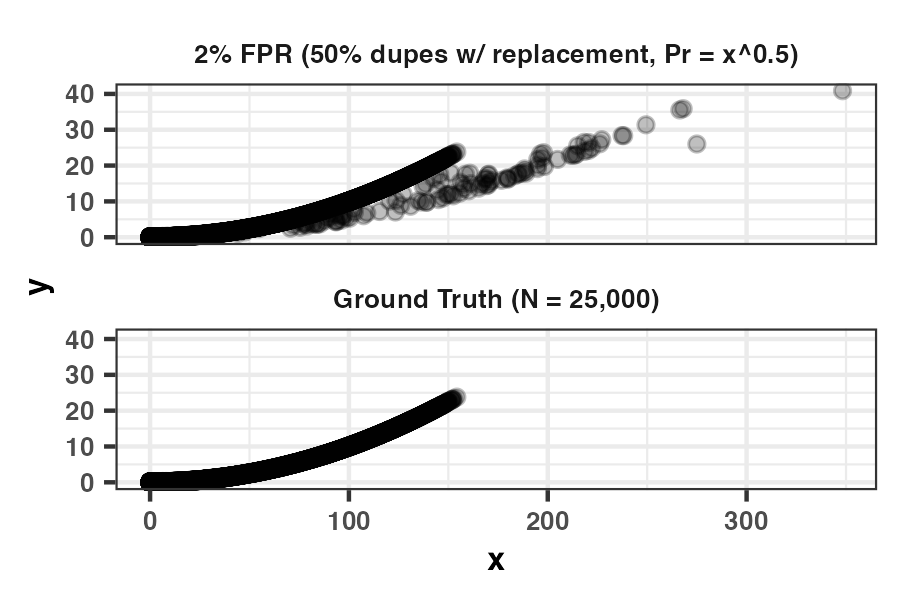

```{css echo=FALSE}

.blocktext {
  background-color: #F2EFFE;
  border-left: 2px solid #2800DE;
  margin-right: 75px;
  margin-left: 75px;
  font-size: 120%;
  padding-top: 30px;
  padding-bottom: 30px;
  padding-left: 10px;
}

.left-col-s {
  float: left;
  width: 40%;
}
.right-col-l {
  float: right;
  width: 58%;
  padding-top: 0;
}
.right-col-l ~ p {
  clear: both;
}

.right-col-s {
  float: right;
  width: 40%;
}
.left-col-l {
  float: left;
  width: 58%;
  padding-top: 0;
}
.left-col-l ~ p {
  clear: both;
}

@media print {
  .has-continuation {
    display: block;
  }
}
.large { font-size: 300% }
.normal { font-size: 100% }
.small { font-size: 85% }
.tiny{font-size: 50%}

.title-slide {
  background-image: url(images/ddss-logo.png);
  background-position: 50% 85%;
  background-size: 20%;
}
```

```{r setup, include=FALSE}
options(htmltools.dir.version = FALSE)
knitr::opts_chunk$set(echo = TRUE,
                      message = FALSE,
                      warning = FALSE,
                      fig.align = "center")

options(scipen = 999, # disable scientific notation
        digits = 3) # shorten digits

pacman::p_load(xaringanthemer,
               kableExtra,
               flipbookr)

style_duo_accent(primary_color = "#2800DE",
                 secondary_color = "#a6005e",
                 link_color = "#455E89",
                 code_inline_color = "#F20089",
                 header_background_color = "#BDA4D3",
                 inverse_text_color = "#000000",
                 header_h1_font_size = "2.25rem",
                 header_h2_font_size = "1.75rem",
                 header_h3_font_size = "1.35rem",
                  table_row_even_background_color = "#F2EFFE",
                  title_slide_background_color = "#F2EFFE",
                  title_slide_text_color = "#2800DE",
                 text_font_size = "1.125rem",
                 text_slide_number_font_size = ".75rem",
                 code_font_size = ".9rem",
                 colors = c(wine = "#64001D",
                            blue = "#003664",
                            green = "#006447",
                            hotpink = "#FF0A54",
                            babypurp = "#F2EFFE",
                            lg = "#BFD8D1",
                            yellow = "#FFF6B4",
                            royal = "#2800DE"))
```

```{r xaringanExtra-clipboard, echo=FALSE}
htmltools::tagList(
  xaringanExtra::use_clipboard(
    button_text = "<i class=\"fa fa-clipboard\"></i>",
    success_text = "<i class=\"fa fa-check\" style=\"color: #90BE6D\"></i>",
  ),
  rmarkdown::html_dependency_font_awesome()
)
```

```{r setup-db, include=F}
#con_d = dbConnect(drv = duckdb(dbdir =  'session2_duck.db', read_only = F))
```

# Session I Agenda

.pull-left[

* Framework

* Step-by-step through the framework

* Basic deterministic setup in DuckDB

* Pitfalls

* Non-human entity linkage

* Sessions II and III overview

* Q & A

]

.pull-right[
Link for today's slides:

[https://tinyurl.com/ddss-sp1](https://tinyurl.com/ddss-sp1)

Recommended R packages:

```{r, eval = F}

library(stringdist)
library(duckdb)

```

]

---
# Fundamental problem(s) of record linkage
--

.center[
The problem is $O(N_AN_B)$ in time and space.
]

Deduplication: $N = 10,000$ generates about 50M comparisons across $k$ linkage fields.

Merge: $N_1 = 10,000, N_2 = 10,000$ generates 100M comparisons.

--

**Some observations** are **obviously** not matches, so we don't need to **compare** them to one another.

--

What's a **match**?

--

|id | first | mi | last | housenum | street | city | zip | st|
|--|------|----|-------|---------|------|------|-----|------|
|1|eric|m|manning|169|nassau|princeton|08540|nj|
|2|ericm||manning|169|nassau||08540||
|3|e||manning|169|nassau||08540||
|4|e||manning|160|nassau||08540||
|5|emily||manning|160|nassau||08540||

???

deduplication is a join of the data to itself

deduplication can't enforce one-to-one

fewer comparisons but skew tends to be more problematic

---
# A basic record linkage workflow*

- *Pre-process* input columns

- Define *blocking* rules

- Define *comparison* criteria

- (*Train* an unsupervised probabilistic model?)

- *Identify matches* by applying comparison criteria to blocked data

- Resolve matches into underlying *clusters* (people, entities, etc.)

- Generate *canonical* output

--

.small[Some approaches blend these steps together.]

---
# Pre-processing

Obviously depends on your linkage fields... Typical considerations:

--

* Case sensitivity

--

* Trimming whitespace
  
--

* Removing punctuation and special characters (accents, etc.)
  - `stringr::stri_trans_general` in R. But are you sure?

--

* Standardizing representation of missing values (`"unknown"`)

--

* Name parsing
  - `install_github('mjfii/Name-Parser')`
  - `humaniformat::`
  - You can typically get away with doing this on you own.
  
---
# Pre-processing: address standardization and parsing (HARD)
--

* USA ZIP codes are easy, but don't forget the northeast
  - Use `stringr::str_pad()`
  - `str_pad('8540', width = 5, side = 'left', pad = '0') = '08540'`

--

* [`libpostal` wrappers in R, Python, etc.](https://github.com/openvenues/libpostal)
  - Trained parser models with good international support

--

* Geocoding as standardization:
  - Census (USA, free); ArcGIS (USA, international; free *for you*)
  - Geohashing

--

* Please don't ever pay for an address parser/geocoder or write your own (US only)

--

* Built-in PostGIS standardization, geocoder (Free, fast, but hard to set up -- ask me for help)

---
# Blocking

Fields on which you must match exactly.*
--

* You will almost certainly drop comparisons between matches.
  - Inherent tradeoff between tractability and false negatives. (Recall in real-world examples is often < 0.75)

* Typically the cleanest/most reliable field(s) your dataset.

* Hopefully high cardinality (GEOIDs >> ZIP codes)

* Required specificity determined by data size, *cardinality,* and compute resources.

* Blocking fields are often skewed (state, first name, last name)

--

.tiny[*Usually.]

---
# Blocking (cont.)


Common exact-match blocking candidates:

--

* Higher level geography (ZIP code)
  - Missingness and accuracy?
  
--

* Gender
  - `Madison` between 1980 and 2000

--

* Substrings of name parts (e.g., first letters)
  - Nicknames, early misspellings

---
# Blocking (cont.)

Example:

- 3.4M SSA births in 1980.

- 19,457 unique names yields 379M comps.

--

- Blocking on gender and first initial: 513B comps.
- Blocking on gender and first two letters: 162B comps.

--

What's wrong with this? `[block] ON jaro_winkler(l.first, r.first) > 0.9`

--

Get creative!

`gender AND zip AND first[1]` OR
`gender AND zip AND last[1]` OR
`gender AND first[1] AND last[1]` OR `zip AND last`...

---
# Constructing blocking indices

* Phonetic (soundex, [double-]metaphone)
  - `{JOHN, JHON, KOHN}` maps to `{J500, J500, K500}`
  
* [Canopy clustering](http://www.kamalnigam.com/papers/canopy-kdd00.pdf)

* Locally sensitive hashing (see Session III)...

--

The *type* of the blocking column (join key) can affect performance.

---
# Comparison functions for strings (distances)

***Levenshtein**: Number of insertions, deletions, substitutions

***Damerau-Levenshtein**: same, but with transpositions
 - Can normalize these to $[0,1]$

--

***Jaccard** (bag of n-grams): $$1 - \frac{|S_1| \cap |S_2|}{|S_1| \cup |S_2|} $$

--

***Jaro**: $\in [0,1]$, function of matching characters and their positions, transpositions

--

***Jaro-Winkler**: Upweights matching at beginning of string
  - Most common for names (and was developed for them)
  
--

***Phonetics** (soundex, [double-]metaphone) ... and **many** others

---
# Comparison functions for strings (similarities)

| Function | "AMELIA" v. "MALIA" | "BETH" v. "LISBETH" | "JOHN v. "JHON"
|----------|---------|------|
| Levenshtein | 0.66 | 0.57 | 0.5 |
| Damerau-Levenshtein | 0.66 | 0.57 | 0.75 |
| Jaccard | 0.8 | 0.57 | 1 |
| Jaro-Winkler| 0.88 | 0 | 0.925 |
| Soundex $\in \{0,1\} \text{ }$ | 0 | 0 | 1 |

---
# Comparisons for other data types

* **Arrays**: intersection, Jaccard

--

* **Geospatial**: lat/long distances (typically Euclidean approx.)

--

* **Dates** (e.g., financial transactions, DOB): probably NOT integer distance (unless good reason)
  - Which pair is the likeliest match?
      - (`2005-03-17`, `1005-03-17`) OR (`2005-03-17`, `2023-02-12`)
  - Beware of `1900-01-01` (missing!) or maybe even `1970-01-01` (UNIX epoch)

--

* **Age**: probably integer distance (e.g., duration between data capture +/- 1 as threshold)

---
# Deterministic matching from comparisons
--

```{r, eval = F}

# cols in dfA, dfB: id, first, last, zip, gender

# dplyr will join data.frames, tibbles, etc. on NULLs 
inner_join(dfA, dfB, by = c('zip', 'gender'), suffix = c('_l','_r')) %>%
  filter(
    stringdist::stringdist(first_l, first_r, 'jw', p = 0.1) >= 0.9,
    stringdist::stringdist(last_l, last_r, 'jw', p = 0.1) >= 0.9
    ) %>%
  select(id_l, id_r)

# then join the NULL gender obs in dfA to all of dfB
# and vice versa

```

--

What's the problem?

---
# Deterministic matching from comparisons (cont.)
--

In, say, `duckdb` :)

```{sql, eval = F}
CREATE TABLE match_inds AS 
  SELECT
    -- return just the indices of the matched pairs:
      l.id AS id_l, r.id AS id_r,
    FROM
      dfA AS l
    INNER JOIN
      dfB AS r
    -- blocking rules:
    ON l.zip = r.zip AND coalesce(l.gender = r.gender, true)
    -- comparison filters:
    WHERE
      jaro_winkler_similarity(l.first, r.first) >= 0.9
      AND jaro_winkler_similarity(l.last, r.last) >= 0.9
;
```

Query is faster and will consume less memory. Will spill to disk if necessary.

---
# Yes, you can still R

```{r, eval = F}
con = dbConnect(duckdb('path_to.db', ...))

tbl(con, 'dfA') %>%
  inner_join(tbl(con, 'dfB'), by = c('zip', 'gender'), suffix = c('_l', '_r')) %>%
  filter(
    jaro_winkler_similarity(first_l, first_r) >= 0.9,
    jaro_winkler_similarity(last_l, last_r) >= 0.9
  ) %>%
  select(id_l, id_r) %>%
  compute(
    name = 'match_inds',
    temporary = F
  )  
```

--

What's different here?

--

Why does `jaro_winkler_similarity(...)` work in the call to `filter()`?

---
# Fellegi-Sunter probabilistic record linkage model

Do you need this? What is your end goal?

--

**Benefit (0)**: You don't have to pre-define all of the possible acceptable combinations of "match" criteria across your comparison fields. You'll train an unsupervised model to do this instead.

--

**Benefit (1)**: We can formalize assumptions necessary to incorporate posterior match probabilities as weights when merged data is outcome or explanatory variable.
.small[.lg[Enamorado, Fifield, and Imai (2019, 357-8)]]

--

**Benefit (2)**: We can incorporate prior match probabilities from existing information (e.g., migration rates, name frequency weighting).
.small[.lg[EFI (2019, 357)]]

--

You must specify blocks, comparison criteria, posterior match probability threshold for a match (sometimes), and (optional) priors.

--

Several robust, efficient implementations across languages.

--

If you have some labeled training data, consider another approach [(example here)](https://www.censustree.org/s/BHPW_july2024.pdf).

---

# Clustering

We have a bunch of matched pairs (with posteriors). Match status might not be transitive. Now what?

--

Most commonly, connected components
  - observations are nodes, matches are edges
  - requires discretizing match status from posteriors

--

Can implement other algorithms (with probabilities as IPWs) if computationally feasible
  - Label propagation

---

# Clustering example

In R, generate graph object from match pairs list and use `igraph::components(graph_obj)`.

In DuckDB,

```{sql, eval = F}
-- INSTALL duckpgq FROM community;
-- LOAD duckpgq;

-- setup
CREATE PROPERTY GRAPH g
  VERTEX TABLES (input_data)
  EDGE TABLES (
    match_inds SOURCE KEY (id_l) REFERENCES input_data (id)
                DESTINATION KEY (id_r) REFERENCES input_data (id)
    LABEL matches
  );

-- returns a component for each unique id in input_data
SELECT * FROM weakly_connected_component(g, input_data, matches);

```

[(See here for manual coding example in Python/DuckDB)](https://www.robinlinacre.com/connected_components/)

---

# Canonicalization

"Best record" for each cluster: Most recent? Most common? One at random? Do you care?
  - Naive bootstrap for records
  - Posteriors (in probabilitist approach) as propensity weights
  - Quickly becoming clear why connected components is dispensing with a lot of potentially useful information...
  - There are [principled ways of doing this](https://arxiv.org/abs/1810.01538)

---
# Pitfalls

Names:

--

*  Nicknames
  - `stringdist::stringsim('ELIZABETH', 'BETH', 'jw', p = 0.1) = 0.45`
  - `(l.first IN r.first_nn) OR (r.first IN l.first_nn)`

--

* Highly skewed distribution of first names
  - A problem for blocking; see also T-F weights in probabilistic approaches

--

* Last name changes (esp. married women in the U.S.)

---
# Potential pitfalls (cont.)

Addresses:

--

- Which parts?

--

- `stringdist::stringsim('5', '6', method='lv') = 0` BUT `stringdist::stringsim('FIFTH', 'SIXTH', method='lv') = 0.6`

--

* Other forms of standardization: `jaro_winkler('NEW YORK CITY', 'NYC') = 0.61`

--

- [Addresses are very weird](https://www.mjt.me.uk/posts/falsehoods-programmers-believe-about-addresses/)

--

- United States: UT and WI have grid systems for some addresses

---
# Potential pitfalls (cont.)

Other considerations:

--

- Missing data in blocking rules
  - Gender imputation

--

- Household overclustering (!)
  - What are your minimal requirements for a match on first name?

---
# False positives (overclustering) and covariate aggregation

<center></center>

---
# (Non-human) entity name matching
--

This is a miserable problem.

--

"J.P. Morgan Chase" vs. "CHASE" vs. "JPMORGON" vs. "JPM"

`"JP MORGAN"` and `"CHASE BANK"` are the same company now (but not before 2000)

--

"FACEBOOK" vs. "META PLATFORMS, INC."

--

There is a string similarity problem AND an information problem.

--

* Nothing else to block on (usually).

--

* If we could create a low-dimensional representation of the characters... 
--

* If we could incorporate outside information...

--

[LinkOrgs](https://github.com/cjerzak/LinkOrgs-software) and its [paper](https://arxiv.org/pdf/2302.02533v3.pdf)

[Kaufman and Klevs (2022). Adaptive Fuzzy String Matching: How to Merge Datasets with Only One (Messy) Identifying Field (Political Analysis)](https://www.cambridge.org/core/journals/political-analysis/article/adaptive-fuzzy-string-matching-how-to-merge-datasets-with-only-one-messy-identifying-field/275D7890548359215AC728C1E35B53CE)

---
# Things we didn't cover

The record linkage/entity resolution literature is enormous. There are many supervised and unsupervised methods, some of which merge some of the steps in our framework.

--

* [Binette and Steorts, _(Almost) All of Entity Resolution_](https://www.science.org/doi/10.1126/sciadv.abi8021)
  - Start here, particularly for newer methods.

--

* [Enamorado, _Active Learning for Probabilistic Record Linkage_](https://dx.doi.org/10.2139/ssrn.3257638)

--

* [Marchant et al., _d-blink: Distributed End-to-End Bayesian Entity Resolution_](https://doi.org/10.48550/arXiv.1909.06039)

---
# Next time: Session II

Fellegi-Sunter model for probabilistic record linkage

--

First, theory setup and EM algorithm.

--

Code-along: [`splink`, a Python package](https://github.com/moj-analytical-services/splink)
* Supports several backends
* Scales to hundreds of millions of records on your laptop
* Generalized blocking, training, comparison functions, and prediction
* Diagnostics, quality assurance, scalability discussion, etc.

---
# After that: Session III

Scaling up, more pitfalls

* What to do when your blocking rules are still too lenient
  - Locally sensitive hashing w/ example
  - `zoomerjoin::` in R
* Deep dive on `splink` tools for diagnostics
* Problems with data skew/partitioning and how to solve them
* Grab bag / email me with requests: `ericmanning@princeton.edu`

---
# Further reading (not cited above)

* Peter Christen (2012), _*Data Matching*_ (Springer)
  - Good overview of workflow, esp. pre-processing topics. Less so for software.

* Harron et al. (2016), _*Methodological Developments in Data Linkage_* (Wiley)
  - Another decent overview -- more stats-heavy.


