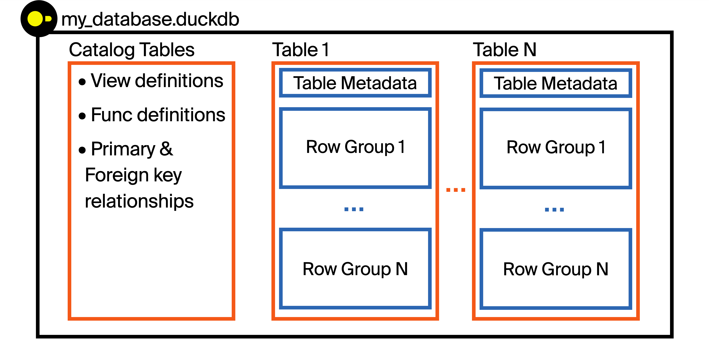
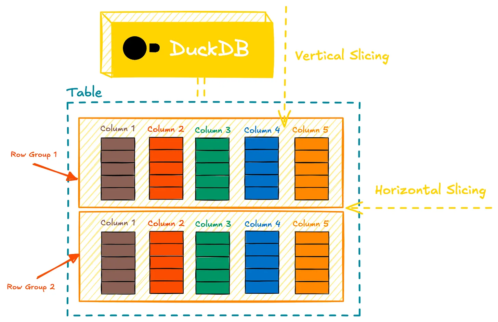

```{css echo=FALSE}

.blocktext {
  background-color: #F2EFFE;
  border-left: 2px solid #2800DE;
  margin-right: 75px;
  margin-left: 75px;
  font-size: 120%;
  padding-top: 30px;
  padding-bottom: 30px;
  padding-left: 10px;
}

.left-col-s {
  float: left;
  width: 40%;
}
.right-col-l {
  float: right;
  width: 58%;
  padding-top: 0;
}
.right-col-l ~ p {
  clear: both;
}

.right-col-s {
  float: right;
  width: 40%;
}
.left-col-l {
  float: left;
  width: 58%;
  padding-top: 0;
}
.left-col-l ~ p {
  clear: both;
}

@media print {
  .has-continuation {
    display: block;
  }
}
.large { font-size: 300% }
.normal { font-size: 100% }
.small { font-size: 85% }
.tiny{font-size: 50%}

.title-slide {
  background-image: url(images/ddss-logo.png);
  background-position: 50% 85%;
  background-size: 20%;
}


```

```{r setup, include=FALSE}
options(htmltools.dir.version = FALSE)
knitr::opts_chunk$set(echo = TRUE,
                      message = FALSE,
                      warning = FALSE,
                      fig.align = "center")

options(scipen = 999, # disable scientific notation
        digits = 3) # shorten digits

pacman::p_load(xaringanthemer,
               kableExtra,
               flipbookr)

style_duo_accent(primary_color = "#2800DE",
                 secondary_color = "#a6005e",
                 link_color = "#455E89",
                 code_inline_color = "#F20089",
                 header_background_color = "#BDA4D3",
                 inverse_text_color = "#000000",
                 header_h1_font_size = "2.25rem",
                 header_h2_font_size = "1.75rem",
                 header_h3_font_size = "1.35rem",
                  table_row_even_background_color = "#F2EFFE",
                  title_slide_background_color = "#F2EFFE",
                  title_slide_text_color = "#2800DE",
                 text_font_size = "1.125rem",
                 text_slide_number_font_size = ".75rem",
                 code_font_size = ".9rem",
                 colors = c(wine = "#64001D",
                            blue = "#003664",
                            green = "#006447",
                            hotpink = "#FF0A54",
                            babypurp = "#F2EFFE",
                            lg = "#BFD8D1",
                            yellow = "#FFF6B4",
                            royal = "#2800DE"))

```

```{r xaringanExtra-clipboard, echo=FALSE}
htmltools::tagList(
  xaringanExtra::use_clipboard(
    button_text = "<i class=\"fa fa-clipboard\"></i>",
    success_text = "<i class=\"fa fa-check\" style=\"color: #90BE6D\"></i>",
  ),
  rmarkdown::html_dependency_font_awesome()
)
```

```{r setup-db, include=F}

```

# Session I Agenda

.pull-left[

Link for today:
[https://tinyurl.com/ddss-sql1](https://tinyurl.com/ddss-sql1)

* Why SQL? Why DuckDB?

* Data ingestion from R

* Basic SQL syntax for common operations

]

.pull-right[

* Code-along 1: 
  - Introducing the CLI
  - SQL practice
  - Some early spatial data
* Code-along #2:
  - Wise(r) data ingestion
  - More practice

* Q & A
* Open RDE office hours
]

---

# If you want to follow along...

R:

```{r, eval = F}
# assuming tidyverse; on linux, this will compile
install.packages(c('duckdb', 'dbplyr'))
```

Python:

```{bash, eval = F}
pip install duckdb
```

CLI:

```{bash, eval = F}
brew install duckdb ## macOS only

winget install DuckDB.cli ## Windows

curl https://install.duckdb.org | sh ## better yet

```

Or, [direct download](https://duckdb.org/docs/installation/) and set PATH (or add this to a location in your PATH)

---

# Why SQL?

* Your data does not fit in active memory

* Most data lives in databases (SQLite, DuckDB, Postgres, MySQL, Oracle, SQL Server, ...)

  * More common in industry (data science/engineering) than (social science) academia

* Relatively easy to read and write

* Similar syntax across databases

* Cloud computing: BigQuery, RedShift, Snowflake, Databricks


---

# Choosing a database backend

.pull-left[
* Client-server (Postgres) v. cloud (Snowflake) v. in-process (`duckdb`, SQLite)
> ''the database system is a linked library that runs completely within a 'host' process'' .tiny[[Source](https://mytherin.github.io/papers/2019-duckdbdemo.pdf)]
  
* OL.hotpink[T]P v. OL.hotpink[A]P
  - ''Online Transactional Processing'' vs. ''Online Analytical Processing''
  - e.g. Some operations on Postgres columns will re-write all columns of relevant rows 
  
* Robustness of features v. [complexity](https://medium.com/nerd-for-tech/postgres-fillfactor-baf3117aca0a)

]
--
.pull-right[

* Compatibility with preferred platforms (R?)

* Speed

* Disk space (compression)

* Permissions for servers (HPC)

]

---

class: middle, center



---

class: middle, center



.small[[Source](https://www.pracdata.io/p/duckdb-beyond-the-hype)]

---

class: middle, center


---

class: middle, center

.large[Examples with]


---
# Set up a database connection in R:

```{r, eval = F}

library(duckdb)

con = dbConnect(
  drv = duckdb(
      dbdir = 'ex.db',
      config = list(
        threads = '6',
        temp_directory = paste0(getwd(),'/tmp/')
)))

out = dbGetQuery(con, "SELECT * FROM duckdb_settings();")

```

See [documentation for configuration options](https://duckdb.org/docs/configuration/overview.html).

---
# Basic writing and selecting:

```{r, eval = F}
DBI::dbWriteTable(conn = con, name = 'iris', value = iris, overwrite = T, append = F)

dbListTables(con)

dbListFields(con, 'iris')

dbGetQuery(con, 'SELECT * FROM iris LIMIT 10')

# adding columns
dbExecute(con, 'ALTER TABLE iris ADD COLUMN large_sepal_length BOOLEAN DEFAULT NULL')
```

--
You have to declare the types! This is good.

---
class: center, middle

Enough R. For now.

---
# SQL Basics: Updating, renaming, and dropping

```{sql, eval = F}

-- set the value of large_sepal_length based on other column
UPDATE iris SET large_sepal_length = "Sepal.Length" > 5;

-- rename the column
ALTER TABLE iris RENAME "Sepal.Length" TO sl;

-- drop the column
-- ALTER TABLE iris DROP COLUMN sl;
```

---
# SQL Basics: Conditioning

```{sql, eval = F}

-- adding a column
ALTER TABLE iris ADD COLUMN large_sepal_length TEXT DEFAULT NULL;

-- case statements 
UPDATE iris SET large_sepal_length =
  CASE
    WHEN sl > 5 THEN 'YES'
    ELSE 'NO'
  END; 

-- alternatively...
UPDATE iris SET large_sepal_length = IF(sl > 5, 'YES', 'NO');
```

---
# SQL Basics: Aggregation

```{sql, eval = F}

-- nrow(iris)
SELECT count(*) AS n FROM iris;

-- unique(iris$Species); distinct(iris, Species)
SELECT DISTINCT Species FROM iris;

-- count(iris, Species)
SELECT Species, count(*) AS n
FROM iris
GROUP BY Species;

-- iris |> group_by(Species) |> summarise(n = n(), msl = max(sl))
SELECT Species, count(*) AS n, max("sl") AS msl
FROM iris
GROUP BY Species;

```

---
# SQL Basics: Dropping subsets, typecasting

```{sql, eval = F}

-- drop all rows where Species == 'setosa'
DELETE FROM iris WHERE Species = 'setosa'; 

-- cast type of sl from integer to varchar
ALTER TABLE iris ALTER "sl" TYPE VARCHAR;

-- alternatively, you can use CAST()
SELECT CAST(sl AS INTEGER) FROM iris;

-- shorthand for above:
SELECT sl::INTEGER FROM iris

```

---
# SQL Basics: Exporting

```{sql, eval = F}

-- https://duckdb.org/docs/sql/statements/copy for more args

COPY (SELECT * FROM iris) TO 'iris_sub.csv' (FORMAT CSV);

```

---
You can also just use `d(b)plyr`!

```{r, eval = F}
library(dplyr)

tbl(con, 'iris') |> filter(Species == 'setosa') 

tbl(con, 'iris') |> filter(Species == 'setosa') |> collect()

tbl(con, 'iris') |> filter(Species == 'setosa') |> show_query()

```

--

```{sql, eval = F}
<SQL>
SELECT iris.*
FROM iris
WHERE (Species = 'setosa')
```

---
# Working programmatically from R

```{r, eval = F}

library(glue)

# iterating over tables:

tbls = dbListTables(con)

for(z in tbls){
  print(z)
  dbGetQuery(con, glue("SELECT count(*) AS N FROM {z}"))
}

```

---
# Cleanup

When you are finished working with the database connection in R, always disconnect:

```{r, eval = F}

dbDisconnect(con)

```

(Concurrency and file locks!)

---

## General SQL pitfall: joining on NULLs
.small[
```{sql, eval = F}
CREATE TABLE tbl1 (a INTEGER, b TEXT);
INSERT INTO tbl1 VALUES (1, 'x'), (10, 'y'), (100, NULL);


CREATE TABLE tbl2 (b TEXT, c INTEGER);
INSERT INTO tbl2 VALUES ('x', 5), ('y', 50), (NULL, 500);

FROM tbl1;
FROM tbl2;

SELECT tbl1.*, c FROM tbl1 INNER JOIN tbl2 ON tbl1.b = tbl2.b;

SELECT tbl1.*, c FROM tbl1 INNER JOIN tbl2 ON tbl1.b IS NOT DISTINCT FROM tbl2.b;

```
]

---

# Code-along 1: County-level presidential results

Objectives:

* Working with the CLI

* Basic data ingestion in SQL

* Windows and joins

* Spatial data import/export

Questions:

* What were the top two Trump counties in each state?

* What were the ten largest counties with the largest shift toward Republicans 2016 -> 2024?

* Ingest result-appended county data into R from DuckDB.

---
class: middle, center

# Code-along 2: Party switching in North Carolina

Ingest North Carolina voter file snapshots to determine what percentage of voters active in both 2016 and 2024 maintained or changed their party affiliation.

---

# Aside: Wiser data ingestion from terminal

```{bash, eval = F}

## 2024 general election voter file
wget -P 'data/' https://s3.amazonaws.com/dl.ncsbe.gov/data/Snapshots/VR_Snapshot_20250101.zip

unzip -p data/VR_Snapshot_20250101.zip | \
  iconv -f UTF-16LE -t UTF-8//IGNORE | \
  duckdb nc.db \
  -c "CREATE OR REPLACE TABLE vf25 AS \
        select ncid, party_desc_17 \
        from read_csv('/dev/stdin') \
        where status_cd = 'A'"

...

```

---

# Next time:

* Session II (_Mon._, Nov. 3) -- Tips for managing very large datasets

  - Hive partitioning reads/writes
  - Updating data via joins
  - Views and CTEs: when and why
  - Reading and writing formats (parquet, database attachments, gross CSVs)
  - More R integrations (without full database management)
  - Syntax tricks (specific to DuckDB)
  - Type-specific functions
  - Special joins
  - Performance tips
  - EXTENSIONS!

---

# Even later:

* Session III (_Mon._, Nov. 10) -- Workflows and Programming w/ SQL

  - Non-interactive use
  - Prepared statements
  - Macros
  - Batch processing with R functions (tips, examples)
  - Recommended SQL IDEs
  - Foreshadowing spring record linkage workshops
  - MORE EXTENSIONS!
  - Your problems


<!-- # Further reading / References -->

<!-- * [Documentation!](https://duckdb.org/docs/index.html) -->

<!-- * [Zero-copy integration between `arrow` and `duckdb`](https://arrow.apache.org/blog/2021/12/03/arrow-duckdb/) -->

<!-- * [Hadley Wickham's *R for Data Science* chapters on databases, `arrow`](https://r4ds.hadley.nz/databases) -->

<!-- * [Some timing + subtle differences in Parquet creation/storage](https://www.christophenicault.com/post/large_dataframe_arrow_duckdb/) -->
