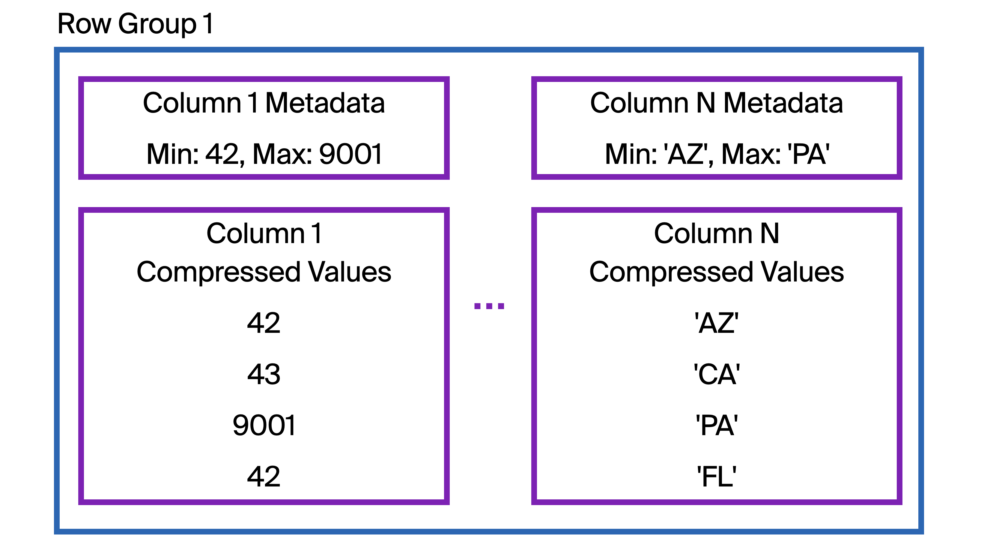

```{css echo=FALSE}

.blocktext {
  background-color: #F2EFFE;
  border-left: 2px solid #2800DE;
  margin-right: 75px;
  margin-left: 75px;
  font-size: 120%;
  padding-top: 30px;
  padding-bottom: 30px;
  padding-left: 10px;
}

.left-col-s {
  float: left;
  width: 40%;
}
.right-col-l {
  float: right;
  width: 58%;
  padding-top: 0;
}
.right-col-l ~ p {
  clear: both;
}

.right-col-s {
  float: right;
  width: 40%;
}
.left-col-l {
  float: left;
  width: 58%;
  padding-top: 0;
}
.left-col-l ~ p {
  clear: both;
}

@media print {
  .has-continuation {
    display: block;
  }
}
.large { font-size: 300% }
.normal { font-size: 100% }
.small { font-size: 85% }
.tiny{font-size: 50%}

.title-slide {
  background-image: url(images/ddss-logo.png);
  background-position: 50% 85%;
  background-size: 20%;
}


```

```{r setup, include=FALSE}
options(htmltools.dir.version = FALSE)
knitr::opts_chunk$set(echo = TRUE,
                      message = FALSE,
                      warning = FALSE,
                      fig.align = "center")

options(scipen = 999, # disable scientific notation
        digits = 3) # shorten digits

pacman::p_load(xaringanthemer,
               kableExtra,
               flipbookr)

style_duo_accent(primary_color = "#2800DE",
                 secondary_color = "#a6005e",
                 link_color = "#455E89",
                 code_inline_color = "#F20089",
                 header_background_color = "#BDA4D3",
                 inverse_text_color = "#000000",
                 header_h1_font_size = "2.25rem",
                 header_h2_font_size = "1.75rem",
                 header_h3_font_size = "1.35rem",
                  table_row_even_background_color = "#F2EFFE",
                  title_slide_background_color = "#F2EFFE",
                  title_slide_text_color = "#2800DE",
                 text_font_size = "1.125rem",
                 text_slide_number_font_size = ".75rem",
                 code_font_size = ".9rem",
                 colors = c(wine = "#64001D",
                            blue = "#003664",
                            green = "#006447",
                            hotpink = "#FF0A54",
                            babypurp = "#F2EFFE",
                            lg = "#BFD8D1",
                            yellow = "#FFF6B4",
                            royal = "#2800DE"))

```

```{r xaringanExtra-clipboard, echo=FALSE}
htmltools::tagList(
  xaringanExtra::use_clipboard(
    button_text = "<i class=\"fa fa-clipboard\"></i>",
    success_text = "<i class=\"fa fa-check\" style=\"color: #90BE6D\"></i>",
  ),
  rmarkdown::html_dependency_font_awesome()
)
```

```{r setup-db, include=F}

```

# Session II agenda: Working with large data

.pull-left[

* Reading and attaching messy input formats

* Optimizing storage and export formats

* More syntax
  - Special joins and type-specific functions
  - Views and CTEs as syntax helpers
* General performance tips

* Manipulating SQL from R/Python for batch processing

]

.pull-right[

Link for today:
[tinyurl.com/ddss-sql-2](tinyurl.com/ddss-sql-2)

At the end:

* Code-along

* Q & A

]
---

# If you want to follow along...

R:

```{r, eval = F}
# assuming tidyverse; on linux, this will compile
install.packages(c('duckdb', 'dbplyr'))
```

Python:

```{bash, eval = F}
pip install duckdb
```

CLI:

```{bash, eval = F}
brew install duckdb ## macOS
winget install DuckDB.cli ## Windows

curl install.duckdb.org | sh ## universal
```

Or, [direct download](https://duckdb.org/docs/installation/) and set PATH.

---
class: middle, center

# Brief review

---

class: middle, center


---

class: middle, center


.small[[Source](https://www.pracdata.io/p/duckdb-beyond-the-hype)]

---

class: middle, center



---

# Brief review: DuckDB from R

```{r, eval = F}

library(duckdb)

con = dbConnect(duckdb(dbdir = 'ex.db'))

DBI::dbWriteTable(conn = con, name = 'iris', value = iris, overwrite = T, append = F)

dbListTables(con)

dbListFields(con, 'iris')

dbGetQuery(con, 'SELECT * FROM iris LIMIT 10')

```

---

# Brief review: Some random SQL

```{sql, eval = F}
ALTER TABLE iris ADD COLUMN large_sepal_length BOOLEAN DEFAULT NULL;
UPDATE iris SET large_sepal_length = "Sepal.Length" > 5;

SELECT Species, count(*) AS n
FROM iris
WHERE large_sepal_length = true
GROUP BY Species;

COPY (SELECT * FROM iris) TO 'iris_sub.csv' (FORMAT CSV);

INSTALL shellfs FROM community;
LOAD shellfs;

CREATE TABLE vf17 AS
  SELECT ncid, party_desc AS party_desc_17
  FROM read_csv('unzip -p data/VR_Snapshot_20170101.zip |', encoding = 'utf-16')
  WHERE status_cd = 'A';
  

```

---
class: middle, center

# Reading and attaching messy input formats

---
# Reading awful CSV files

Look at `data/fault1.csv`:

| id    | person | dept |
| -------- | ------- |
| 1  | Eric    | DDSS
| 2 | John     | ECON
| three    | Mary    | POL

--

What happens if I...

```{sql, eval = F}
SELECT * FROM read_csv('data/fault1.csv')
```

--

```{sql, eval = F}
SELECT *
FROM read_csv(
  'data/fault1.csv',
  columns = {'id':'INT', 'person':'TEXT', 'dept':'TEXT'}
  );
```

---
# Reading awful CSV files

CSV jail:

```{sql, eval = F}

CREATE TABLE students AS
  FROM read_csv(
    'data/fault2.csv',
    columns = {'id':'INT', 'person':'TEXT', 'dept':'TEXT'},
    store_rejects = true
  );

FROM reject_scans;

FROM reject_errors; 

```

(demo)

---
# More convenience features/arguments:

Can read .csv.gz files efficiently.

--

* [General CSV import documentation](https://duckdb.org/docs/data/csv/overview)
* [Description of CSV auto-detection parameters](https://duckdb.org/docs/data/csv/auto_detection.html)
* [Documentation for error table(s)](https://duckdb.org/docs/data/csv/reading_faulty_csv_files.html)
* [Blog post about internal CSV sniffer](https://duckdb.org/2023/10/27/csv-sniffer.html)

--

Some additional useful arguments:

- `all_varchar`
- `columns`
- `header`
- `filename`
- `nullstr` (one or more)
- `skip`
- `sample_size`
- `union_by_name` (with _read_csv(['file1.csv', 'file2.csv'])_)

---
# Database attachments

You can query (without copy), read, and write other database formats from DuckDB.

--

Example:

```{sql, eval = F}
INSTALL sqlite;
LOAD sqlite;

ATTACH 'horrendous_dataverse_file.db' AS dv (TYPE SQLITE);
SELECT * FROM dv.tbl;
```
--

I can also write to this file:
```{sql, eval = F}
CREATE TABLE dv.tbl (id INTEGER, name VARCHAR); ...
```

--

This also works for [Postgres](https://duckdb.org/docs/extensions/postgres), [MySQL](https://duckdb.org/docs/extensions/mysql), etc. Also all the major cloud services.

---
class: center, middle

# Optimizing storage and export formats

---
# Parquet files

* Row-group and column-based compressed storage (with file- and chunk-level metadata)
  - VERY good for analytic queries and parallelization
  - Similar to internal storage layout of DuckDB

* Maintains schema (!)

* You should be writing, saving, and sharing tabular data in Parquet format. 

--

```{sql, eval = F}

SELECT * FROM parquet_schema('data/nyc-taxi/year=2019/month=1/part-0.parquet');

DESCRIBE SELECT * FROM 'data/nyc-taxi/year=2019/month=1/part-0.parquet';

```

---
# Hive partitioning

(Example in `data/`, sourced from [arrow.apache.org](https://arrow.apache.org/docs/r/articles/dataset.html))

How to read:

```{sql, eval = F}

FROM read_parquet('data/nyc-taxi/**/*.parquet') LIMIT 10;

-- what's different here?
FROM read_parquet('data/nyc-taxi/**/*.parquet', hive_partitioning = false) LIMIT 10;

```


---
# Why hive partitioning?

Why? [*_Filter pushdown_*](https://duckdb.org/docs/data/partitioning/hive_partitioning.html#filter-pushdown):

> Filters on the partition keys are automatically pushed down into the files. This way the system skips reading files that are not necessary to answer a query.

```{sql, eval = F}
EXPLAIN SELECT COUNT(*) FROM read_parquet('data/nyc-taxi/**/*.parquet') WHERE year = 2009;
```

---
# Reading hive-partitioned data

Explicit typecasting:
```{sql, eval = F}
SELECT *
FROM read_parquet(
    'data/nyc-taxi/**/*.parquet',
    hive_partitioning = true,
    hive_types = {'year' : INT, 'month': TEXT}
)
LIMIT 10;
```

Note: Here the columns are all the same! What if they aren't? (Use `union_by_name = true`)

---
# Writing hive-partitioned data

```{sql, eval = F}
COPY (SELECT ... FROM ...) TO
  'some/path/' (FORMAT PARQUET, PARTITION_BY (year, month));

```

> By default the partitioned write will not allow overwriting existing directories.

If you want it to (??), you can add `OVERWRITE_OR_IGNORE` flag to the args.

---
class: middle, center

# More syntax

---
# Updating data via joins

You want to update values in table A based on values in table B. (Why not output the result of a join?)

--

General syntax:
```{sql, eval = F}
UPDATE original
    SET value = new.value
    FROM new
    WHERE original.key = new.key;
```

[Source](https://duckdb.org/docs/sql/statements/update.html)

--

You can update multiple columns, too:

```{sql, eval = F}
UPDATE original
    SET (value1, value2) = (new.value1, new.value2)
    FROM new
    WHERE original.key = new.key;
```

---
# Upserts (a blend of inserts and updates)

Inserting data into existing table:

```{sql, eval = F}

INSERT INTO tbl1 [BY NAME]
[SELECT ...] FROM tbl2 
```

--

What if some of the rows already exist?

---
# Upserts

```{sql, eval = F}
-- setup
CREATE TABLE tbl(i int, j int, PRIMARY KEY (i));
INSERT INTO tbl VALUES (1, 11), (2, 22), (3, 33); 

INSERT INTO tbl VALUES (2, 44) ON CONFLICT (i) DO UPDATE SET j = excluded.j;

```

--

```{sql, eval = F}
INSERT OR IGNORE INTO tbl VALUES (1, 84);

-- same as:
INSERT INTO tbl VALUES (1, 84) ON CONFLICT DO NOTHING;
```

---
# Special joins

* Range joins

```{sql, eval = F}
SELECT * FROM tbl1 JOIN tbl2 ON tbl1.id = tbl2.id AND tbl1.z >= tbl2.z;
```

* [As-of joins](https://duckdb.org/docs/guides/sql_features/asof_join)

```{sql, eval = F}
-- value of the stock (symbol) AS OF this trade...
SELECT t.*, p.price
FROM trades t
ASOF JOIN prices p -- inner join! can also do ASOF LEFT JOIN
ON t.symbol = p.symbol
  AND t.time >= p.time;
```

* Positional (!) joins (`cbind`)

```{sql, eval = F}
FROM t1 POSITIONAL JOIN t2;
```

---
# Views and common table expressions (CTEs) as syntax helpers

What is a view?

--

It's just a lazy table, basically -- "a query pretending to be a table".

--

```{sql, eval = F}

CREATE VIEW rides AS
  FROM read_parquet('nyc-taxi/**/*.parquet');

CREATE VIEW rides_sum AS
  SELECT count(*) AS n, year, month
  FROM rides
  GROUP BY year, month;

EXPLAIN SELECT * FROM rides_sum; -- executes entire pipeline

```

--

Why would you do this?

---
# Common table expressions (CTEs)

Last time:

```{sql, eval = F}
SELECT
  c1.fips,
  100*(c2.dv/c2.tpv - c1.dv/c1.tpv) AS dem_shift
FROM (
  FROM results
  WHERE election_year = 2016
  ) c1
INNER JOIN (
  FROM results
  WHERE election_year = 2020
  ) c2
ON c1.fips = c2.fips
ORDER BY dem_shift DESC
LIMIT 10;
```

---
# Common table expressions (CTEs)

With CTEs:

```{sql, eval = F}

WITH
  c1 AS (FROM results WHERE election_year = 2016), 
  c2 AS (FROM results WHERE election_year = 2020)
SELECT ...
FROM c1
INNER JOIN c2
ON ...;
```

---
# Common table expressions (CTEs)

You can nest them:

```{sql, eval = F}
WITH
    cte1 AS (SELECT 42 AS i),
    cte2 AS (SELECT i * 100 AS x FROM cte1)
SELECT * FROM cte2;
```

--

You can also make them recursive. This is especially useful for, e.g., [graph traversals](https://duckdb.org/docs/sql/query_syntax/with.html).


---
# Type-specific functions in DuckDB (general)

* Support for many useful [aggregate expressions](https://duckdb.org/docs/sql/functions/aggregates) (incl. basic functionality for printed histograms and linear regressions!)

* [Date formatting](https://duckdb.org/docs/sql/functions/dateformat) and intervals

```{sql, eval = F}
SELECT strptime('Monday, 2 March 1992 - 08:32:45 PM', '%A, %-d %B %Y - %I:%M:%S %p');
SELECT DATE '1992-03-27' - INTERVAL 5 DAY;
```

* Create UUIDs (unique IDs)

```{sql, eval = F}
SELECT uuidv7();
SELECT uuid_extract_timestamp(uuidv7());
```

* Null handling:

```{sql, eval = F}
SELECT coalesce(NULL, NULL, 1);
```

---

# Type-specific functions in DuckDB (record linkage department)

* Full support for [regular expressions](https://duckdb.org/docs/sql/functions/regular_expressions)
  - extract, detect, split, replace, ...

* Strip accents from string (for, e.g., name matching):

```{sql, eval = F}
SELECT strip_accents('tést');
```

* Concatenate many strings, separated by `separator` (NULL inputs are skipped):
```{sql, eval = F}
SELECT concat_ws(', ', 'Manning', NULL, 'Eric');
```

* Levenshtein, Jaccard, Jaro, Jaro-Winkler, Damerau-Levenshtein string similarity functions

---
# Sampling

Several [ways](https://duckdb.org/docs/sql/samples.html) to do this:

```{sql, eval = F}

FROM tbl USING SAMPLE 10 [PERCENT/ROWS] (reservoir, 123); -- reservoir sampling

FROM tbl USING SAMPLE 10 PERCENT (system, 123); -- system (cluster) sampling

FROM tbl USING SAMPLE 10 PERCENT (bernoulli, 123); -- Bernoulli sampling

```

--

> Reservoir sampling is a stream sampling technique that selects a random sample by keeping a reservoir of size equal to the sample size, and randomly replacing elements as more elements come in. [...] Avoid using reservoir sampling with large sample sizes if possible. Reservoir sampling requires the entire sample to be materialized in memory.

--

System (cluster) sampling is faster, but not random if rows are not randomly ordered!

---
class: middle, center

# General performance tips

---
# General performance tips

* 1-4 GB memory per thread (N threads is configurable)
* "DuckDB works best on Parquet files with row groups of 100K-1M rows each"
  - "The ideal range is between 100 MB and 10 GB per individual Parquet file."
* Be aware of out-of-core spilling.
* Use the most restrictive types possible when creating columns.
  - Joining on strings is slower than than joining on integers.
* "Do not define constraints unless your goal is to ensure data integrity."
  - They get checked when you alter data.
* Try to order your tables by commonly-queried columns when writing them.
  - Takes advantage of min/max indices!

See ["Performance documentation"](https://duckdb.org/docs/stable/guides/performance/overview) and/or ["Out-of-Memory Error Troubleshooting."](https://duckdb.org/docs/stable/guides/troubleshooting/oom_errors)


---
class: middle, center

# Manipulating SQL from R/Python for batch processing

---
# Batch processing

- Problem: We have some R/Python-specific function we want to apply to each row of a DB table (or subset). Let's say we can't write a [UDF](https://duckdb.org/docs/stable/clients/python/function#creating-functions) for some reason.

- Input: Some subset of columns in the table.

- Output: One (or more) column(s) that we want to append back to the table (or at least store somewhere).

---
# Batch processing the normal way

```{r, eval = F}
# con = dbConnect(duckdb('data/ex.db'))

total = dbGetQuery(con, 'SELECT COUNT(*) AS n FROM iris')$n

get_batches = dbSendQuery(con, 'SELECT Species, "Sepal.Length" FROM iris')

while (!dbHasCompleted(get_batches)) {
  
  this_chunk = dbFetch(get_batches, n = 5)
  
  ## do stuff here...
  
  count_processed = get_batches@env$rows_fetched
  print(glue('Processed {100* round(count_processed/total, 2)}%'))
}

dbClearResult(get_batches)
```

---
# Potential problems

- If your "stuff" is an update statement, it won't commit the change. (Try it!)

- This is not resilient to timeouts or crashes. (You can't pick up where you left off.)

--

So what do we do?

---

# Exercise

You need to apply a custom function `f(col1) -> col2` on the `iris` table in the database. (It doesn't matter what it does. It might fail sometimes, too.)

Unfortunately you can't fit every row (even just `col1`) in R memory. You can accept no more than _*five*_ unprocessed rows of the data.

Write a workflow that executes the function in R and assigns the output values to the column `col2` in the database, and terminates when _*complete*_.

(A) Update the database directly.

(B) Write partial outputs somewhere else (and join back later). (Why?)

---

# Next time

* Session III (_Mon._, Nov. 10 -- Next week!)

  - Non-interactive use
  - Prepared statements and macros
  - Recommended SQL IDEs
  - Extensions and the DuckDB ecosystem (*)
  - More R integrations (*)
  - Foreshadowing spring record linkage series
  - Your problems...
  
Recommendations: ericmanning@princeton.edu

---
# Further reading from the DuckDB blog:

* [Tricks Pt. 1](https://duckdb.org/2024/08/19/duckdb-tricks-part-1.html)
* [Tricks Pt. 2](https://duckdb.org/2024/10/11/duckdb-tricks-part-2.html)
* [Friendlier SQL](https://duckdb.org/2022/05/04/friendlier-sql.html)
* [Even Friendlier SQL](https://duckdb.org/2023/08/23/even-friendlier-sql.html)
* [SQL Gymnastics](https://duckdb.org/2024/03/01/sql-gymnastics.html)

Sample code and snippets: [https://duckdbsnippets.com/](https://duckdbsnippets.com/)

