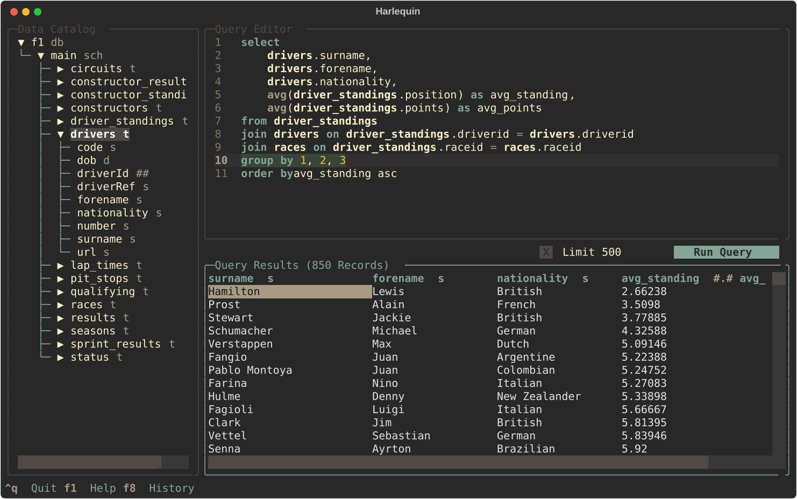

```{css echo=FALSE}

.blocktext {
  background-color: #F2EFFE;
  border-left: 2px solid #2800DE;
  margin-right: 75px;
  margin-left: 75px;
  font-size: 120%;
  padding-top: 30px;
  padding-bottom: 30px;
  padding-left: 10px;
}

.left-col-s {
  float: left;
  width: 40%;
}
.right-col-l {
  float: right;
  width: 58%;
  padding-top: 0;
}
.right-col-l ~ p {
  clear: both;
}

.right-col-s {
  float: right;
  width: 40%;
}
.left-col-l {
  float: left;
  width: 58%;
  padding-top: 0;
}
.left-col-l ~ p {
  clear: both;
}

@media print {
  .has-continuation {
    display: block;
  }
}
.large { font-size: 300% }
.normal { font-size: 100% }
.small { font-size: 85% }
.tiny{font-size: 50%}

.title-slide {
  background-image: url(images/ddss-logo.png);
  background-position: 50% 85%;
  background-size: 20%;
}


```

```{r setup, include=FALSE}
options(htmltools.dir.version = FALSE)
knitr::opts_chunk$set(echo = TRUE,
                      message = FALSE,
                      warning = FALSE,
                      fig.align = "center")

options(scipen = 999, # disable scientific notation
        digits = 3) # shorten digits

pacman::p_load(xaringanthemer,
               kableExtra,
               flipbookr)

style_duo_accent(primary_color = "#2800DE",
                 secondary_color = "#a6005e",
                 link_color = "#455E89",
                 code_inline_color = "#F20089",
                 header_background_color = "#BDA4D3",
                 inverse_text_color = "#000000",
                 header_h1_font_size = "2.25rem",
                 header_h2_font_size = "1.75rem",
                 header_h3_font_size = "1.35rem",
                  table_row_even_background_color = "#F2EFFE",
                  title_slide_background_color = "#F2EFFE",
                  title_slide_text_color = "#2800DE",
                 text_font_size = "1.125rem",
                 text_slide_number_font_size = ".75rem",
                 code_font_size = ".9rem",
                 colors = c(wine = "#64001D",
                            blue = "#003664",
                            green = "#006447",
                            hotpink = "#FF0A54",
                            babypurp = "#F2EFFE",
                            lg = "#BFD8D1",
                            yellow = "#FFF6B4",
                            royal = "#2800DE"))

```

```{r xaringanExtra-clipboard, echo=FALSE}
htmltools::tagList(
  xaringanExtra::use_clipboard(
    button_text = "<i class=\"fa fa-clipboard\"></i>",
    success_text = "<i class=\"fa fa-check\" style=\"color: #90BE6D\"></i>",
  ),
  rmarkdown::html_dependency_font_awesome()
)
```

```{r setup-db, include=F}

```

# Session III agenda: More workflows in SQL and R

.pull-left[

* Syntax: Prepared statements and macros for programming

* Non-interactive use / more R integrations

* Recommended IDEs

* Extensions and the DuckDB ecosystem

* Foreshadowing spring record linkage series
  - Non-probabilistic linkage at scale

]

.pull-right[

Link for today:
[tinyurl.com/ddss-sql-3](tinyurl.com/ddss-sql-3)

Q & A / open office hours at the end

]
---

# If you want to follow along...

R:

```{r, eval = F}
# assuming tidyverse; on linux, this will compile
install.packages(c('duckdb', 'dbplyr'))
```

Python:

```{bash, eval = F}
pip install duckdb
```

CLI:

```{bash, eval = F}
brew install duckdb ## macOS
winget install DuckDB.cli ## Windows

curl install.duckdb.org | sh ## universal
```

Or, [direct download](https://duckdb.org/docs/installation/) and set PATH.

---
class: middle, center

# More SQL syntax

---

# Prepared statements

Use `PREPARE` to create statements with value placeholders.

## Method 1: Auto-incrementing
```{sql, eval = F}
PREPARE get_iris_subset_a AS
    SELECT *
    FROM iris
    WHERE Species == ?
      AND "Sepal.Length" >= ?;
```

--

Run:

```{sql, eval = F}
EXECUTE get_iris_subset_a('setosa', 5);
```

---
# Prepared statements

Use `PREPARE` to create statements with value placeholders.

## Method 2: Positional

```{sql, eval = F}
PREPARE get_iris_subset_p AS
    SELECT *
    FROM iris
    WHERE Species == $1
      AND "Sepal.Length" >= $2;
```

--
Execute the same way:

```{sql, eval = F}
EXECUTE get_iris_subset_p('setosa', 5);
```

---
# Prepared statements

Use `PREPARE` to create statements (`SELECT`, `INSERT`, `UPDATE`, etc...) with value placeholders.

## Method 3: Named

You can also name the parameters (probably a good idea!)

```{sql, eval = F}
PREPARE get_iris_subset_n AS
    SELECT *
    FROM iris
    WHERE Species == $sp
      AND "Sepal.Length" >= $ln;
```

--

Execute with (required) parameter names:

```{sql, eval = F}
EXECUTE get_iris_subset_n(sp := 'setosa', ln := 5);
```

---
# Prepared statements

## Dropping statements

```{sql, eval = F}
DEALLOCATE get_iris_subset_a;
DEALLOCATE get_iris_subset_p;
DEALLOCATE get_iris_subset_n;
```

---

# Extending prepared statements to tables

You can use `query()` and `query_table()` in prepared statements.

--

`query()` takes a SELECT statement as a string and will execute it. Avoid.

--

`query_table()` takes a table name as a string and will return the table reference:

```{sql, eval = F}
PREPARE get_data_subset_n AS
    SELECT *
    FROM query_table($tb)
    WHERE Species == $sp
      AND "Sepal.Length" >= $ln;
```

--

```{sql, eval = F}
EXECUTE get_data_subset_n(tb := 'iris', sp := 'setosa', ln := 5);
```

---

# Macros

They are function constructors that get called in subsequent (sub)queries. Two kinds: scalar and table.

--

## Scalar macro example:

--
```{sql, eval = F}
CREATE MACRO add(a, b) AS a + b;
```

--
You can pass args or arrays (or nothing), e.g.

```{sql, eval = F}
CREATE MACRO fav_number() AS (SELECT 08540);
CREATE MACRO fancy_average(z) AS sum(z) / count(z);
```

---
# Macros

## Table macros

Must execute some kind of `SELECT` statement. Returns a table.

```{sql, eval = F}
CREATE MACRO subset_iris(sp, ln) AS TABLE
  SELECT *
  FROM iris
  WHERE Species = sp
    AND "Sepal.Length" >= ln;
  
FROM subset_iris('setosa', 5);
```

---
# Macros

Macros can have default values, just like R functions.

```{sql, eval = F}
CREATE MACRO subset_iris_2(sp, ln := '-infinity') AS TABLE
  SELECT *
  FROM iris
  WHERE Species = sp
    AND "Sepal.Length" >= ln;
    
FROM subset_iris_2('setosa');
```

--
What happens if I run this?

```{sql, eval = F}
FROM subset_iris_2('setosa', 5);
```

--

Correct:
```{sql, eval = F}
FROM subset_iris_2('setosa', ln := 5) -- named things must be named
```

---
# Macros

You can "overload" macros, too.

```{sql, eval = F}
CREATE OR REPLACE MACRO subset_iris_3
    (sp) AS TABLE (
      FROM iris
      WHERE Species = sp
      ),
    (sp, ln) AS TABLE (
      FROM iris
      WHERE Species = sp
        AND "Sepal.Length" >= ln
      );
```

Now, execution depends on number of args:

```{sql, eval = F}
FROM subset_iris_3('setosa');

FROM subset_iris_3('setosa', 5);
```

---
# While we are discussing syntax...

A brief note on update statements...

```{sql, eval = F}

ALTER TABLE tbl ADD COLUMN colB VARCHAR DEFAULT NULL;
UPDATE tbl SET colB = foo(colA);

```

If `foo(colA)` is a large operation (e.g., string manipulation on a giant table column), you'll sometimes get:

`duckdb.duckdb.OutOfMemoryException: Out of Memory Error: failed to pin block of size 256.0 KiB (476.7 MiB/476.8 MiB used)`

---
# Troubleshooting OOMs

Options:

- Reduce threads (`SET threads = ...`)
- Try `SET preserve_insertion_order = false`
- Reduce memory limit (why?): `SET memory_limit = '10GB'`

--

Easiest (hack):

```{R, eval = F}

for(i in unique(years)) dbExecute(con, glue("UPDATE tbl SET colB = foo(colA) WHERE year = {i}"))

```

---
class: middle, center

# Non-interactive use and more R integration

---
# Non-interactive use

Very easy (from terminal):

```{sh, eval = F}
duckdb /path/to/ex.db < script.sql
```

--

Alternatively, inside the CLI, run a script:

```{sql, eval = F}
.read script.sql
```

---
# Non-interactive use

If you have outputs, you can write them to a Markdown file (`.mode csv/tabs/json` or `.mode latex` also works!):

```{sql, eval = F}
.mode markdown
.output /path/to/output.md

FROM generate_series(5);

-- switch back with
.output
.mode duckbox 
```

More dot commands: [duckdb.org/docs/stable/clients/cli/dot_commands](https://duckdb.org/docs/stable/clients/cli/dot_commands)

---
# Non-interactive use

Remember from the first session: You can use read from `stdin` and write to `stdout` (e.g., in bash pipes):

```{bash, eval = F}
unzip -p data/VR_Snapshot_20250101.zip | \
  iconv -f UTF-16LE -t UTF-8//IGNORE | \
  duckdb nc.db \
  -c "CREATE OR REPLACE TABLE vf25 AS \
        select ncid, party_desc_17 \
        from read_csv('/dev/stdin') \
        where status_cd = 'A'"
```

--

This means DuckDB can be used for quick on-the-fly ops:

```{bash, eval = F}
cat some.csv | \
  duckdb -c "COPY \
    (SELECT colA, colB FROM read_csv('/dev/stdin') WHERE some_condition) \
    TO '/dev/stdout' WITH (FORMAT CSV, HEADER) \
    " | \
  anotherCommand
```

---
# Running scripts from R

You can execute code in `.sql` scripts from R:

```{r, eval = F}
# con = dbConnect(duckdb('data/ex.db'))

dbExecute(con, statement = readr::read_file('script.sql'))
```

This is not ideal. You should try to work programmatically within R scripts or execute SQL scripts directly from terminal or bash script.

---
# More `d(b)plyr`

You will recall

```{R, eval = F}

tbl(con, 'iris') |> filter(...) |> select(...) |> show_query()

```

--

You may also do things like:

```{r, eval = F}
tbl(con, 'iris') |> mutate(colB = foo(colA)) ## where `foo` is SQL function
tbl(con, 'iris') |> mutate(colC = as.integer(colA)) ## what happens here?
```

--

Alternatively,

```{r, eval = F}
tbl(con, 'iris') |> mutate(colC = sql("CAST(colA AS INT)"))
```

---
# Using `glue::`

You've seen me do things like:

```{r, eval = F}
dbExecute(con, glue("UPDATE tbl SET var = thing WHERE other_var = '{other_thing}'"))
```

--

But you can also use `glue::glue_sql()`

```{r, eval = F}

t1 = 'tbl'
v1 = 'var'; val1 = 'thing'
v2 = 'other_var'; val2 = 'other_thing'

q = glue_sql("UPDATE {`t1`} SET {`v1`} = {val1} WHERE {`v2`} = {val2}", .con = con)
dbExecute(con, q)

```

---
# More `d(b)plyr`

What's so great about that??

--

1) Backquote _variables_, don't quote _values_

--

2) As an example...

```{r, eval = F}

val2 = c('other_thing', 'yet_another_thing') 
glue_sql("UPDATE {`t1`} SET {`v1`} = {val1} WHERE {`v2`} IN ({val2*})", .con = con)

## or supply it as named arg to glue_sql
glue_sql("SELECT {`cols`*} FROM {`t1`}", cols = c('colA', 'colB'), .con = con)

## note slight change in syntax for vectors vs. exploding cols

```

--

Also useful for programming with more complex subqueries.

There's also a cross-table syntax that you'd use for joins (see `glue_sql` docs). I think it's messier than using `dbplyr` to construct and execute SQL.

---
class: middle, center

# Recommended SQL IDEs

---
# RStudio (obviously)

You can use RStudio to browse DuckDB file contents in the Connections pane, but it takes a bit of [work](https://rstudio.github.io/connections/):

```{r, eval = F}
# install.packages("remotes")
# remotes::install_github("rstudio/connections")

library(connections)
con = connection_open(duckdb('data/ex.db'))
# see Connections pane now
connection_close(con); rm(con)
```

--

You can also read/write SQL files in RStudio and execute them in the UI, but you can't run them line by line.

---
# Terminal IDE: Harlequin

Good for DuckDB, SQLite, Postgres, etc. [Documentation here: https://harlequin.sh/](https://harlequin.sh/)

<center></center>

---
# Harlequin: Basic usage

Launch:
```{sh, eval = F}
harlequin "data/ex.db" --show-files . # or whatever project dir you want as root
```

This will work on Della.

---
# Better yet...

DuckDB has a native UI, which is an extension.

```{bash, eval = F}
duckdb -ui optional_file.db
-- or
duckdb -cmd "create table tbl as from 'some_file.parquet';" -ui optional_file.db
```

OR, from within a running connection:

```{sql, eval = F}
CALL start_ui();

-- optional: SET ui_local_port = 4213;
-- CALL start_ui_server(); 
```

--

This will NOT work on Della or any air-gapped environment (but the data/queries are still local).

---
class: middle, center

# Extensions and the DuckDB Ecosystem

---
# Core Extensions

Built by the DuckDB team. Examples:
- encodings
- spatial
- vss
- ui
- postgres
- sqlite

```{sql, eval = F}
INSTALL thing; LOAD thing;

-- UPDATE EXTENSIONS;
```

--

These will fetch from duckdb.org. If you are firewalled, download and migrate. See:
[duckdb.org/docs/stable/extensions/advanced_installation_methods](https://duckdb.org/docs/stable/extensions/advanced_installation_methods)

---
# Community Extensions

Not built by DuckDB, but built and distributed by DuckDB. See [duckdb.org/community_extensions/list_of_extensions](https://duckdb.org/community_extensions/list_of_extensions)

```{sql, eval = F}
INSTALL thing FROM community;
LOAD thing;
```

Examples:
.pull-left[
- duckpgq
- infera
- mlpack
- shellfs
- stochastic
]

.pull-right[
- h3
- rapidfuzz
- splink_udfs
- title_mapper
]

The folks at [Query.Farm](https://query.farm/duckdb_extensions.html) are always up to something.

---
# Community Extensions, cont.

You can wrap pretty much any C++/C/Rust function, vectorized or otherwise. Come talk to us about your needs.

---
# Ecosystem

There are many well-developed tools and packages that are powered by DuckDB. See [davidgasquez/awesome-duckdb](https://github.com/davidgasquez/awesome-duckdb).

--

The most important for you is probably [Splink](https://moj-analytical-services.github.io/splink/).

---
class: middle, center

# Previewing spring record linkage workshops

---
# Basic record linkage

Record linkage/entity resolution/deduplication as a joining problem... We want to join two datasets (or the same dataset to itself). Steps:

1. Pre-processing

2. Blocking rules

3. Comparison criteria

4. Identify matches

5. Resolve (cluster) matches into identifiers

---
# Deterministic record linkage

```{r, eval = F}
# cols in dfA, dfB: id, first, last, zip, gender
# dplyr will join data.frames, tibbles, etc. on NULLs 

inner_join(dfA, dfB, by = c('zip', 'gender'), suffix = c('_l','_r')) %>%
  filter(
    stringdist(first_l, first_r, 'jw', p = 0.1) >= 0.9,
    stringdist(last_l, last_r, 'jw', p = 0.1) >= 0.9
    ) %>%
  select(id_l, id_r)

# then join the NULL gender obs in dfA to all of dfB
# and vice versa
```

What's the problem?

---
# Deterministic record linkage

```{sql, eval = F}

CREATE TABLE match_inds AS (
  SELECT
    -- return just the indices of the matched pairs:
      l.id AS id_l, r.id AS id_r,
    FROM
      dfA AS l
    INNER JOIN
      dfB AS r
    -- blocking rules:
    ON l.zip = r.zip AND coalesce(l.gender = r.gender, true)
    -- comparison filters:
    WHERE
      jaro_winkler_similarity(l.first, r.first) >= 0.9
      AND jaro_winkler_similarity(l.last, r.last) >= 0.9
);
```

The point: Query is faster, will consume less memory, and spills to disk if necessary.

---
# Further tools

- A popular, fully-featured IDE for relational databases: [DataGrip](https://www.jetbrains.com/datagrip/)
  - Some people also like [DBeaver](https://dbeaver.io/).

- A nice dashboarding tool (for those of you in labs): [Evidence.dev](https://evidence.dev/)

---
class: middle, center

ericmanning@princeton.edu
