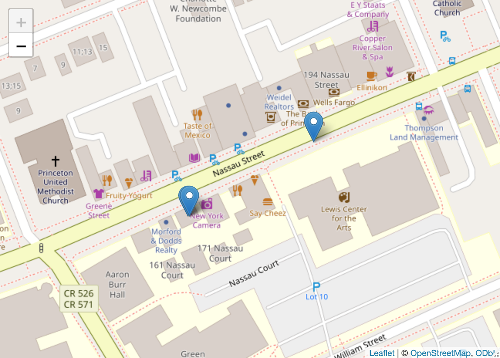
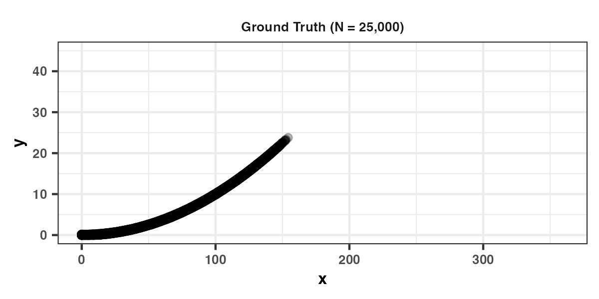
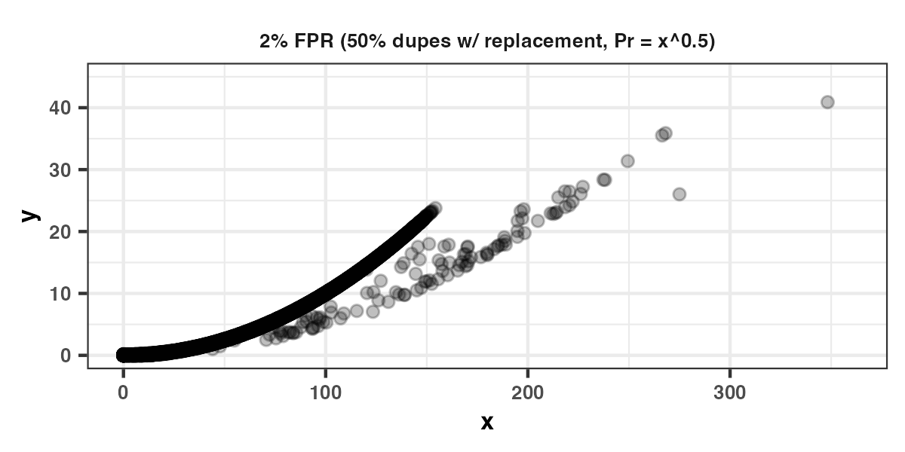
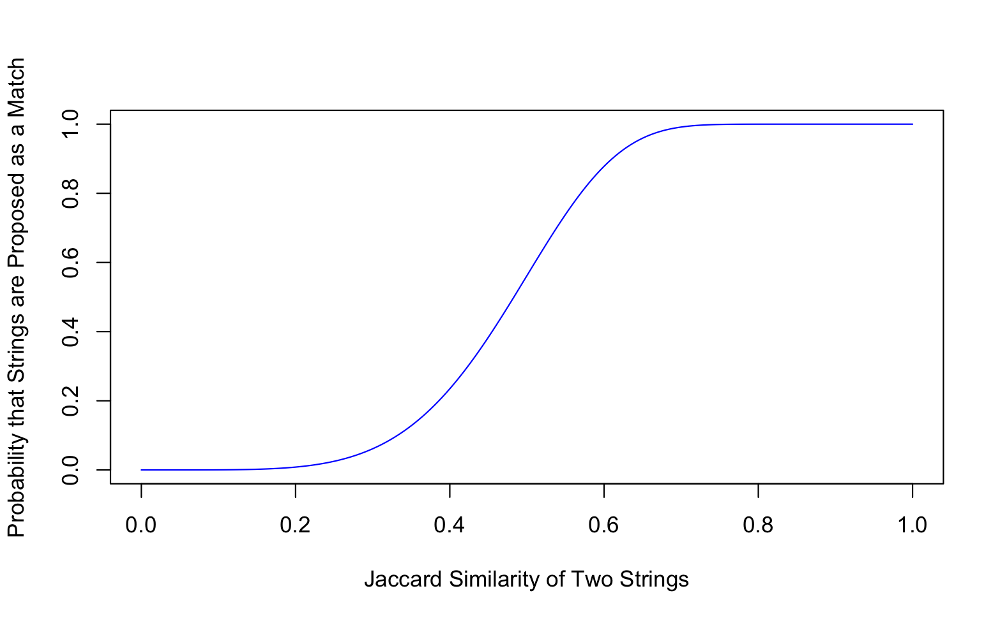

---
format:
  revealjs:
    theme: default
    slide-number: true
    highlight-style: github
    code-copy: true
    embed-resources: true
    code-line-numbers: false
    css: ddss.css
    height: 700
    width: 1400

execute:
  echo: true
  eval: false
  message: false
  warning: false
  fig-align: center
---

```{=html}
<style>
  .reveal .backgrounds > .slide-background:first-child {
    background-image: url('images/title-bg.svg');
    background-size: cover;
    background-position: center;
  }
</style>

<br>
<br>
<br>
<h1>Record Linkage Bootcamp</h1>
<br>
<h2>for Social Science Data</h2>
<hr><br>
<div style="display: flex; align-items: center; justify-content: space-between; padding: 0 2rem;">
  <div>
    <p style="font-size: 1.3em; font-weight: 600; margin: 0 0 0.2em 0;">Eric Manning, PhD</p>
    <p style="font-size: 1.0em; margin: 0;">February 27, 2026</p>
  </div>
  
</div>
<br><br>
```

<center>`r fontawesome::fa("github", "black")` &nbsp; [ericmanning / rl-bootcamp](https://github.com/ericmanning/rl-bootcamp)</center>

```{r}
#| label: setup
#| include: false

options(scipen = 999, digits = 3)
```

## What is this? Who are you?
<hr><br>

::: {.fragment fragment-index="1"}

### Why a bootcamp (and not 🤖)

<br> 
:::

:::: {.columns}
::: {.column width="30%"}

::: {.fragment fragment-index="2"}
### What this is not...
* Statistics lecture
* Failsafe cookbook
:::

:::
::: {.column width="70%"}

::: {.fragment fragment-index="3"}
### Objectives
* "I can form an outline of the implementation steps in my head."
* "For each step, I know some things that might go wrong."
* "I can tell 🤖 what I want... and I can usually tell when it's misguided."
:::

:::
::::

::: {.fragment fragment-index="4"}

<br>

### About us 👋
:::


## Bootcamp agenda
<hr><br>

:::: {.columns}
::: {.column width="50%"}

<br>

### 1) The framework
::: {.fragment fragment-index="1"}
* Step-by-step through the ER framework
* Deterministic examples
:::

<br>

### 3) In practice
::: {.fragment fragment-index="3"}
* Some time with non-human data inputs
* Your research
:::

:::
::: {.column width="50%"}

<br>

### 2) The classic: Fellegi-Sunter
::: {.fragment fragment-index="2"}
* Basic probabilistic setup
* Some notation, then demos
:::

<br>

### 4) The frontier
::: {.fragment fragment-index="4"}
* AI-/LLM-enhanced linkage
* What to do when you don't trust your blocks (LSH)
:::

:::
::::


## Bootcamp setup

<hr><br>

Recommended R packages:
```{r}
#| eval: false 
install.packages(c(
  'dbplyr',     # imports a bunch of stuff
  'fastLink',   # imports stringdist
  'igraph',
  'duckdb',
  'fuzzylink',
  'zoomerjoin'
))
```

<br>
<br>

Python:
```{python}
#| eval: false
uv add splink   # incl. duckdb
```

# 1) The framework

## Fundamental problems of record linkage: feasibility

<hr><br>

**Problem 1:** The task is $O(N_AN_B)$

<br>

. . .

For merges, $N_1 = N_2 = 10,000$ generates 100M comparisons across each of $k$ linkage fields.

<br>

. . .

Deduplication: 50M comparisons.

<br>

. . .

**Solution:** _Some observations_ are almost certainly not matches, so we don't need to compare them.

## Fundamental problems of record linkage: definitional

<hr><br>

**Problem 2:** What is a "match?"

<br>

. . .

<table>
  <thead>
    <tr>
      <th>id</th>
      <th>first</th>
      <th>mi</th>
      <th>last</th>
      <th>housenum</th>
      <th>street</th>
      <th>city</th>
      <th>zip</th>
      <th>st</th>
    </tr>
  </thead>
  <tbody>
    <tr class="fragment">
      <td>1</td>
      <td>eric</td>
      <td>m</td>
      <td>manning</td>
      <td>169</td>
      <td>nassau</td>
      <td>princeton</td>
      <td>08540</td>
      <td>nj</td>
    </tr>
    <tr class="fragment">
      <td>2</td>
      <td>ericm</td>
      <td></td>
      <td>manning</td>
      <td>169</td>
      <td>nassau</td>
      <td></td>
      <td>08540</td>
      <td></td>
    </tr>
    <tr class="fragment">
      <td>3</td>
      <td>e</td>
      <td></td>
      <td>manning</td>
      <td>169</td>
      <td>nassau</td>
      <td></td>
      <td>08540</td>
      <td></td>
    </tr>
    <tr class="fragment">
      <td>4</td>
      <td>e</td>
      <td></td>
      <td>manning</td>
      <td>160</td>
      <td>nassau</td>
      <td></td>
      <td>08540</td>
      <td></td>
    </tr>
    <tr class="fragment">
      <td>5</td>
      <td>emily</td>
      <td></td>
      <td>manning</td>
      <td>160</td>
      <td>nassau</td>
      <td></td>
      <td>08540</td>
      <td></td>
    </tr>
  </tbody>
</table>

. . .

<br>

**Solution:** Know your data well. Examine _large clusters_, esp. those with _partial matches_.

## A basic record linkage workflow

<hr><br>

**1.** *Pre-process* input columns

. . .

**2.** Define *blocking* rules

. . .

**3.** Define *comparison* criteria

. . .

**3a.** *Train* an unsupervised probabilistic model?

. . .

**4.** *Match* by applying comparison criteria to blocked data

. . .

**5.** Resolve matches into underlying *clusters* (people, entities, etc.)

. . .

**6.** Generate *canonical* output

. . .

<br>

**Some approaches blend these steps together (say, redefine comparison criteria iteratively based on match quality).**

## Brief foreshadowing

<hr><br>

Basic deterministic linkage by first + last name (comparisons) within ZIP codes + gender (blocks)...

. . .

```{sql}
-- cols in dfA, dfB: id, first, last, zip, gender (M/F/NULL)
-- return just the indices of the matched pairs

SELECT l.id AS id_l, r.id AS id_r
FROM dfA AS l
INNER JOIN dfB AS r
-- blocking rules:
ON l.zip = r.zip AND COALESCE(l.gender = r.gender, true)
-- comparison filters:
WHERE
  jaro_winkler_similarity(l.first, r.first) >= 0.9
  AND jaro_winkler_similarity(l.last, r.last) >= 0.9;
```

# Step 1: Pre-processing

## Pre-processing: generic strings

<hr><br>

Typical considerations:

* Standardizing representation of missing values (`"unknown"`, `"NA"`, `"NULL"` `""`)
* Case sensitivity
* Trimming whitespace

. . .

* Removing punctuation and special characters (accents, etc.)
  + `stringr::stri_trans_general` in R.
  + But are you sure?

## Pre-processing: human name strings

<hr><br>

The goal (usually):

:::: {.columns}
::: {.column width="40%"}

::: {.fragment fragment-index="1"}
::: {.small}
| name | 
|:------|
|   ERIC MANNING  |
|  Eric M Manning  |
|    MANNING, ERIC M MR.  |
| eric m. manning jr |
:::
:::

:::
:::{.column width="60%"}

::: {.fragment fragment-index="2"}
:::{.small}
| name_first | name_middle | name_last | name_suffix | 
|:------|:-----|:--------|:------|
| eric |  | manning |  |
| eric |  m |   manning   |    |
| eric |   m |   manning   |    |
| eric | m | manning | jr|
:::
:::

:::
::::

<br>

::: {.fragment fragment-index="3"}
:::{.small}

* Name parsing options in R
  - `install_github('mjfii/Name-Parser')`
  - `install_github('Nonprofit-Open-Data-Collective/peopleparser')`
  - `humaniformat::`
* Many Python libraries
* You can typically get away with doing (some of) this on your own.
:::
:::


## Pre-processing: addresses

<hr><br>

This is generally quite hard if the addresses are not already pre-processed.

. . .

Addresses as strings... in two stages:

* Parsing into constituent components (house number, street name, ...)
* Standardization of each component ("STREET" to "ST")

. . .

* USA ZIP codes are easy, but don't forget the northeast
  - Use `stringr::str_pad()`
  - `str_pad('8540', width = 5, side = 'left', pad = '0') == '08540'`

. . .

Addresses are [very weird](https://www.mjt.me.uk/posts/falsehoods-programmers-believe-about-addresses/). Please do not attempt to standardize them on your own unless you are willing to dedicate a lot of time to building your own tool.

## Pre-processing: tools for addresses

<hr><br>

:::{.incremental}
* [`libpostal` wrappers in R, Python, etc.](https://github.com/openvenues/libpostal)
  + Trained parser models with good international support
  + [`Rpostal`](https://github.com/Datactuariat/Rpostal): R bindings to `libpostal` C library
  + Works well for international addresses in many languages
* [`usps-scourgify`](https://github.com/GreenBuildingRegistry/usaddress-scourgify): Lighter Python library for standardization
* [`addressr`](https://github.com/EvictionLab/addressr): Eviction Lab's address parser (for R)
* [PostGIS in PostgreSQL](https://postgis.net/docs/Extras.html) (free, fast, local, but hard-ish to set up; you can ask me for help)
:::

. . .

<br> 

Or... use any (other) geocoder.

## Pre-processing: PostGIS (in Postgres) standardizer

<hr><br>

```{sql}
SELECT (each(hstore(p))).* FROM standardize_address(
  'tiger.pagc_lex', 'tiger.pagc_gaz', 'tiger.pagc_rules',
  'One Devonshire Place, PH 301, Boston, MA 02109'
) AS p;
```

:::{style="font-size: 0.2em;"}
```

    key     |      value
------------+-----------------
 box        |
 city       | BOSTON
 name       | DEVONSHIRE
 qual       |
 unit       | # PENTHOUSE 301
 extra      |
 state      | MA
 predir     |
 sufdir     |
 country    | USA
 pretype    |
 suftype    | PL
 building   |
 postcode   | 02109
 house_num  | 1
 ruralroute |
```
:::

## Pre-processing: geocoding addresses

<hr><br>

Geocoding usually comes with standardization:

  + Census (USA, free); ArcGIS (USA, international; free *for you*)

. . .

<br>

**Please don't ever pay for an address parser or geocoder (US only).**

. . .

<br>

Geocoding converts messy address strings into structured lat/long coordinates. This means:

::: {.incremental}
* You can compare **geospatial distance** and (or instead of) address strings
* Geocodes are **standardized**: misspellings, abbreviations, etc. all collapse to same coordinates
* Geohashes or spatial indices (like H3) become natural **blocking keys**
:::

## Pre-processing: Geocoding in R using `tidygeocoder`

<hr><br>

Use the Census API for bulk geocoding (10k batches):

<br>

```{r}
#| eval: false

addr = data.frame(a='169 Nassau Street, Princeton, NJ, 08540')

tidygeocoder::geocode(addr, method = 'census', address = 'a', verbose = T)
```

<br>

```
## # A tibble: 1 x 3
##   a                                         lat  long
##   <chr>                                   <dbl> <dbl>
## 1 169 Nassau Street, Princeton, NJ, 08540  40.4 -74.7
```

. . .

<br> 

You can parallelize batches and the Census API will, generally, cooperate.

## Pre-processing: Parallelized Census geocoding

<hr><br>

```{r}
#| eval: false
#| code-overflow: wrap
#| 
geo_out = pbmclapply(
  geo_input,
  FUN = \(.x) {
    geocode(
      .x,
      street = geo_in, city = city, state = state, postalcode = zip,
      method = "census", full_results = TRUE,
      api_options = list(census_return_type = 'geographies'),
      custom_query = list(vintage = 'Census2010_Current')
    )[, keep_vars]
  },
  mc.cores = parallel::detectCores() - 1, mc.preschedule = F
)

```

## Pre-processing: Other `tidygeocoder` features

<hr><br>

Cascading (useful when one service doesn't cover all your addresses):

```{r}
#| eval: false

geocode_combine(
  data.frame(a=c('169 Nassau Street, Princeton, NJ, 08540',
                 'Anfield, Liverpool, UK')),
  queries = list(
    list(method = 'census'),
    list(method = 'osm')
  ),
  global_params = list(address = 'a'),
  cascade = T
)
```

<br>

```
## # A tibble: 2 x 4
##   a                                         lat   long query
##   <chr>                                   <dbl>  <dbl> <chr>
## 1 169 Nassau Street, Princeton, NJ, 08540  40.4 -74.7  census
## 2 Anfield, Liverpool, UK                   53.4  -2.96 osm
```

## Pre-processing: Comparing geocoding service quality

<hr><br>

```{r}
#| eval: false

out = lapply(c('osm', 'arcgis', 'census'),
  \(x) geocode(addr, method = x, address = 'a') %>% mutate(class = x)
) %>% bind_rows()

leaflet() %>% addTiles() %>% addMarkers(data = out, label = out$class)
```

<center></center>

## Geocoding: practical considerations

<hr><br>

:::{.incremental}
* ArcGIS will support ~1M geocodes/hour (with address standardization)
  - Consumes (library) credits unless you set up locally (see me)
  - International coverage

* OpenStreetMap (OSM) coverage varies by country with rolling updates

* IRB/other regulatory limitations to uploading address data

* Local solution desirable for data ingestion pipelines (maybe)
:::

# Step 2: Blocking

## Blocking

<hr><br>

A blocking field is (usually) just a join key (i.e., exact match required).

. . .

Considerations:

:::{.incremental}
* You will almost certainly drop comparisons between matches.
  - Inherent tradeoff between tractability and false negatives.
  - Recall in real-world examples is often < 0.75.
* Typically the cleanest/most reliable field(s) in your dataset.
* Hopefully high cardinality (GEOIDs >> ZIP codes)
* Blocking fields are often skewed (state, first name, last name)
* Required specificity determined by data size, skew, cardinality of blocking vars, and compute resources.
* Join key types typically affect performance quite a bit. Avoid strings if possible.
:::

. . .

**_KNOW YOUR DATA WELL ENOUGH TO SELECT GOOD BLOCKS._**

## Blocking: Example of reduction in comparison space

<hr><br>

There were 3.4M SSA births in 1980. What if we compared everyone to each other?

. . .

11.7 **tr**illion comparisons.

. . .

<br>

What if we block on gender?

. . .

5.9 **tr**illion comparisons.

. . .

<br>

What if we block on gender and first initial?

. . .

513 **b**illion comparisons.

. . .

<br>

What if we block on gender and first name?

. . .

47 **b**illion comparisons (~12min w/ DuckDB's Jaro-Winkler)

## Blocking: Practical considerations

<hr><br>

What's wrong with this?

```{sql}
[ ... ]
FROM dfA l
INNER JOIN dfB r
ON jaro_winkler_similarity(l.first, r.first) > 0.9

```

<br>

. . .

Get creative!

```{sql}
FROM dfA l
INNER JOIN dfB r
ON (l.zip = r.zip AND l.first = r.first)
  OR (coalesce(l.gender = r.gender, true) AND l.zip = r.zip AND l.last = r.last)
  OR (coalesce(l.gender = r.gender, true) AND l.first[1] = r.first[1] AND l.last[1] = r.last[1])
  OR (l.zip = r.ZIP AND l.last = r.last)
  [ ... ]
```

## Blocking: common blocking variables and their problems

* Higher level geography (city, state, ZIP code)
  + Cities are often misspelled or abbreviated (`"New York City"` vs. `"NYC"`)
  
. . .

* Gender (usually imputed from SSA records)
  + `Madison` between 1980 and 2000

. . .

* Names (or their substrings -- e.g., first letters)
  + Beware misspellings early in strings
  + What about nicknames? (more later)
    - `(l.first IN r.first_nicknames) OR (r.first IN l.first_nicknames)`
  + Beware last name changes by gender

. . .

Be sure you handle missingness as intended.

* Joining on nulls?

## Blocking: Constructing new indices

<hr><br>

Sometimes we don't have clean join keys _anywhere_.

. . .

* Convert name strings to phonetic representations (soundex, [double-]metaphone)
  - `{JOHN, JHON, KOHN}` maps to `{J500, J500, K500}`

. . .

* [Canopy clustering](http://www.kamalnigam.com/papers/canopy-kdd00.pdf)

. . .

* Locally sensitive hashing (later) for strings or points

. . .

* Cosine similarity/nearest neighbors with semantic embeddings for strings (later)

. . .

What about geospatial data?

## Blocking with H3: Hexagonal hierarchical indexing

<hr><br>

:::: {.columns}
::: {.column width="55%"}

::: {.fragment fragment-index="1"}
[H3](https://h3geo.org/) (Uber) tiles the globe into nested hexagons at 16 resolutions.

* Each lat/long = one H3 cell index (a 64-bit integer).

* Resolution controls block size (res 6 ≈ 36 km², res 8 ≈ 0.74 km²)
:::

::: {.fragment fragment-index="2"}

**Key idea for blocking:** expand each cell to a *k-ring* (cell + all neighbors within $k$ steps) and compare only within overlaps.

:::

::: {.fragment fragment-index="3"}

There are APIs for basically every language.

:::

:::
::: {.column width="45%"}

)](https://h3geo.org/images/parent-child.png)

:::
::::


## H3 Blocking Example in DuckDB

<hr><br>

```{sql}
INSTALL h3 FROM community; LOAD h3;

CREATE TABLE records AS FROM (VALUES
  (1, 40.7128, -74.0060),
  (2, 34.0522, -118.2437),
  (3, 40.7282, -74.0776)
) t(id, lat, lng);

ALTER TABLE records ADD COLUMN h3 UBIGINT;
UPDATE records SET h3 = h3_latlng_to_cell(lat, lng, 3); -- ~68km len

SELECT a.id AS id_a, b.id AS id_b
FROM records a JOIN records b
ON h3_grid_distance(a.h3, b.h3) <= 1 -- overlapping 1-neighbor k-rings
  AND a.id < b.id;
```

# Step 3: Defining comparisons

## Comparisons: string distance (1 - similarity) functions

<hr><br>

. . .

**Levenshtein**: Number of insertions, deletions, substitutions

**Damerau-Levenshtein**: same, but with transpositions

. . .

**Jaccard** (bag of n-grams): $$1 - \frac{|S_1 \cap S_2|}{|S_1 \cup S_2|}$$

. . .

**Jaro**: $\in [0,1]$, function of matching characters and their positions, transpositions

. . .

**Jaro-Winkler**: Upweights matching at beginning of string
  - Most common for names (developed for them)

. . .

**Phonetics** (soundex, [double-]metaphone) ... and **many** others

. . .

<br>

More recently, **token sort ratio functions** (e.g., via [RapidFuzz](https://rapidfuzz.github.io/RapidFuzz/Usage/fuzz.html))

## Comparison functions for strings (similarities)

<hr><br>

| Function | (AMELIA, MALIA) | (BETH, LISBETH) | (JOHN, JHON) |
|:--------------------------|---------------------:|---------------------:|------------------:|
| Levenshtein | 0.66 | 0.57 | 0.50 |
| Damerau-Levenshtein | 0.66 | 0.57 | 0.75 |
| Jaccard | 0.80 | 0.57 | 1.00 |
| Jaro-Winkler | 0.88 | 0 | 0.93 |
| Soundex (0 or 1) | 0 | 0 | 1.00 |

. . .

Notes:

```{r}
stringdist::stringsim('NEW YORK CITY', 'NYC', 'jaccard')     # 0.27
stringdist::stringsim('ELIZABETH', 'BETH', 'jw')             # 0.45
stringdist::stringsim('5th AVE', '6th AVE', method='jw')     # 0.90
## but...
stringdist::stringsim('FIFTH AVE', 'SIXTH AVE', method='jw') # 0.85
```

## Comparisons for other data types

<hr><br>

:::{.incremental}
* **Arrays**: any intersection (or Jaccard)
* **Geospatial**: lat/long distances (typically Euclidean approx.)
* **Dates**: probably NOT int distance (unless good reason)
  + Which pair is the likeliest match?
    - (`2005-03-17`, `1005-03-17`) OR (`2005-03-17`, `2023-02-12`)
  + Beware of `1900-01-01` (missing!) or maybe even `1970-01-01` (UNIX epoch)
* **Age**: int distance (e.g., duration between data capture +/- 1 as threshold)
:::

. . .

How to handle addresses?

# Step 4 (maybe): Model training

## Training: when and why
<hr><br>

Deterministic output: $\mathbb{P}(M_{ij}) \in \{0,1\}$

<br> 

. . .


This assumes you _know_ the criteria that defines a match (well enough).

. . .

<br>

But what if you don't? (Or what if you want a posterior probability?)

## Training: Probabilistic model types

<hr><br>

Basic probabilistic model types:

:::{.incremental}
* **Unsupervised**: Fellegi-Sunter model (later)
  + Catch: You have to define the blocking rules and the comparison levels for each field
  + Benefits: Posteriors; not writing out all comparison combinations in a big rule set
* **Supervised**: Train some observation pairs, then train a predictive model (`xgboost`, probably)
  + Catch: You have to label data (which data??)
  + Benefit: Comparison levels and/or fields learn complex relationships
  + Example: [Census Tree Project](https://doi.org/10.1016/j.eeh.2025.101717)
* **Semi-supervised**: human-in-the-loop active learning approaches
    - [Python's `dedupe`](https://github.com/dedupeio/dedupe)
    - [Enamorado, *Active Learning for Probabilistic Record Linkage*](https://dx.doi.org/10.2139/ssrn.3257638)
:::

# Step 5: Matching

## Basic deterministic matching: wrong

<hr><br>

What's wrong with the following?

<br>

```{r}
#| eval: false

# cols in dfA, dfB: id, first, last, zip, gender

# dplyr will join data.frames, tibbles, etc. on NULLs
inner_join(dfA, dfB, by = c('zip', 'gender'), suffix = c('_l','_r')) |>
  filter(
    stringdist::stringdist(first_l, first_r, 'jw', p = 0.1) >= 0.9,
    stringdist::stringdist(last_l,  last_r,  'jw', p = 0.1) >= 0.9
  ) |>
  select(id_l, id_r)

# then join the NULL gender obs in dfA to all of dfB
# and vice versa
```

## Basic deterministic matching (correctly, from R)

<hr><br>

```{sql}
CREATE TABLE match_inds AS
  SELECT
    -- return just the indices of the matched pairs:
    l.id AS id_l, r.id AS id_r
  FROM
    dfA AS l
  INNER JOIN
    dfB AS r
  -- blocking rules:
  ON l.zip = r.zip AND coalesce(l.gender = r.gender, true)
  -- comparison filters:
  WHERE
    jaro_winkler_similarity(l.first, r.first) >= 0.9
    AND jaro_winkler_similarity(l.last, r.last) >= 0.9
;
```

Query is faster and will consume less memory. Will spill to disk if necessary.

## Basic deterministic matching (correctly, from R)

<hr><br>

```{r}
#| eval: false

con = dbConnect(duckdb('path_to.db', ...))

tbl(con, 'dfA') |>
  inner_join(tbl(con, 'dfB'), by = c('zip', 'gender'), suffix = c('_l', '_r')) |>
  filter(
    jaro_winkler_similarity(first_l, first_r) >= 0.9,
    jaro_winkler_similarity(last_l,  last_r)  >= 0.9
  ) |>
  select(id_l, id_r) |>
  compute(
    name      = 'match_inds',
    temporary = FALSE
  )
```

. . .

Remember! What's different here vs. base R?

. . .

Why does `jaro_winkler_similarity(...)` work in the call to `filter()`?

# Step 6: Clustering

## Clustering

<hr><br>

We have a bunch of matched pairs (with posteriors). Match status might not be transitive. Now what?

. . .

Most commonly, **connected components**

:::{.incremental}
* Observations are nodes, matches are edges
* Find all (connected) clusters
* Requires discretizing match status from posteriors
:::

. . .

Can implement other algorithms (with probabilities as IPWs) if computationally feasible (e.g., label propagation).

. . .

* See community detection algorithms in the `onager` extension for DuckDB [here](https://cogitatortech.github.io/onager/guide/community/).

## Clustering example

<hr><br>

In R, generate graph object from match pairs list and use `igraph::components(graph_obj)`.

. . .

In DuckDB:

```{sql}
install onager from community;
load onager;

create table edges as
select *
from (values (1::bigint, 2::bigint),
             (2, 3),
             (3, 1),
             (4, 5),
             (5, 6)) t(src, dst);

from onager_cmm_components((select src, dst from edges))
```

. . .

(What's the answer?)

. . .

See [here](https://www.robinlinacre.com/connected_components/) for manual coding example in Python/DuckDB

## Clustering: common issues

<hr><br>

Household overclustering (!!)

 - What are your minimal requirements for a match on first name?

. . .

Overclustering is particularly important for descriptive relationships...

## (Over-)Clustering example

<hr>

<center></center>

. . .

<center></center>

# Step 7: Canonicalization

## Canonicalization

In some cases, you may need the "best record" for each cluster.

:::{.incremental}
* Most recent?
* Most common?
* One at random?
:::

. . .

Some options for inference:

:::{.incremental}
- Naive bootstrap for records
- Posteriors (in probabilistic approach) as sampling or propensity weights
- Quickly becoming clear why connected components is dispensing with a lot of potentially useful information...
- There are [principled ways of doing this](https://arxiv.org/abs/1810.01538)
:::

# ☕

# 2) The Classic: Fellegi-Sunter PRL

## Fellegi-Sunter probabilistic record linkage model

Fellegi and Sunter (1969, [_JASA_](https://www.cs.cornell.edu/~shmat/courses/cs6434/fellegi-sunter.pdf)) | Enamorado, Fifield, and Imai (2019, [_APSR_](https://imai.fas.harvard.edu/research/files/linkage.pdf))

<hr><br>

Do you need this? What is your end goal?

. . .

**Benefit (0)**: You don't define all of the possible "match" criteria combinations across linkage fields or label any label data.

. . .

**Benefit (1)**: We formalize assumptions necessary to incorporate posterior match probabilities as weights when merged data is outcome or explanatory variable.\

. . .

**Benefit (2)**: We can incorporate prior match probabilities from existing information (e.g., migration rates, name frequency weighting).

. . .

You must specify blocks, comparison criteria/levels, posterior threshold for a match (sometimes), and (optional) priors.

. . .

Several robust, efficient implementations across languages.


## Fellegi-Sunter: setup
Less math-heavy tutorial from [Linacre (here)](https://www.robinlinacre.com/probabilistic_linkage/).

<hr><br>

Suppose we are matching datasets $A$ and $B$ across $K$ fields.

. . .

Similarity between $i \in A, j \in B$ in field $k$ is $S_k(i,j)$, typically $\in [0,1]$.

. . .

We coarsen this similarity to an agreement pattern $\gamma_k(i,j)$ where:
$$\gamma_k(i,j) =
\begin{cases}
2 & S_k(i,j) \geq \tau_2 \\
1 & \tau_1 \leq S_l < \tau_2 \\
0 & \text{otherwise}
\end{cases}$$

. . .

This is generalizable to distance metrics, discrete metrics (e.g., Levenshtein), etc.

. . .

For $i, j$, we have $\boldsymbol{\gamma}(i,j) = \{\gamma_1(i,j), ..., \gamma_k(i,j)\}$ with some number of agreement levels $L_k$.

## Fellegi-Sunter: missingness

<hr><br>

Missingness is recorded as $\delta_k(i,j)$ where:
$$\delta_k(i,j) =
\begin{cases}
1 & \text{if either } i_k \text{ or } j_k \text{ missing} \\
0 & \text{otherwise}
\end{cases}$$

. . .

Let $m\in \{0,1\}$ be the (unknown) match status for $i,j$, which is distributed

$$ M(i,j) \stackrel{iid}{\sim} \text{Bernoulli}(\lambda) $$

. . .

Assume that the probability of each agreement level is distributed

$$\gamma_k(i,j) | M(i,j) = m \stackrel{indep}{\sim} \text{Discrete}(\boldsymbol{\pi}_{km})$$

## Fellegi-Sunter: math (likelihood function)

<hr><br>

The parameters $\boldsymbol{\gamma}, \boldsymbol{\delta}$ are given by the observed data. The observed data likelihood, then, is: $l_{\text{obsv}}(\lambda, \boldsymbol{\pi} | \boldsymbol{\delta}, \boldsymbol{\gamma}) \propto$

$$\prod_{i=1}^{N_A} \prod_{j=1}^{N_B}
    \left\{ \sum_{m=0}^{1} \lambda^m (1-\lambda)^{1-m} \prod_{k = 1}^{K}
    \left( \prod_{l=1}^{L_k-1} \pi_{kml}^{\boldsymbol{1}\{\gamma_k(i,j) = l\}}\right)^{1-\delta_{k}(i,j)}\right\}$$

The probability of $(i,j)$ being a match is:

\begin{equation*}
        \begin{split}
            \xi_{i,j} & = \mathbb{P}(M_{ij} = 1 | \boldsymbol{\delta}(ij),\boldsymbol{\gamma}(i,j)) \\
            &= \frac{\lambda \prod_{k = 1}^{K} \left(\prod_{l=1}^{L_k-1} \pi_{k1l}^{\boldsymbol{1}\{\gamma_k(i,j) = l\}} \right)^{1-\delta_{k}(i,j)}}{\sum_{m=0}^{1}\left\{\lambda^m(1-\lambda)^{1-m} \prod_{k = 1}^{K} \left(\prod_{l=1}^{L_k-1} \pi_{kml}^{\boldsymbol{1}\{\gamma_k(i,j) = l\}} \right)^{1-\delta_{k}(i,j)}\right\}}
        \end{split}
        \end{equation*}

## Fellegi-Sunter: more math (the E-M part)

<hr><br>

\begin{equation*}
        \begin{split}
            \xi_{i,j} & = \text{Pr}(M_{ij} = 1 | \boldsymbol{\delta}(ij),\boldsymbol{\gamma}(i,j)) \\
            &= \frac{\lambda \prod_{k = 1}^{K} \left(\prod_{l=1}^{L_k-1} \pi_{k1l}^{\boldsymbol{1}\{\gamma_k(i,j) = l\}} \right)^{1-\delta_{k}(i,j)}}{\sum_{m=0}^{1}\left\{\lambda^m(1-\lambda)^{1-m} \prod_{k = 1}^{K} \left(\prod_{l=1}^{L_k-1} \pi_{kml}^{\boldsymbol{1}\{\gamma_k(i,j) = l\}} \right)^{1-\delta_{k}(i,j)}\right\}}
        \end{split}
        \end{equation*}

We need to compute the $\lambda$ and the $\pi_{kml}$ parameters, given by:

\begin{equation*}
            \begin{split}
                \lambda &= \frac{1}{N_A N_B}\sum_{i =1}^{N_A}\sum_{j=1}^{N_B} \xi_{ij} \\
                \pi_{kml} &= \frac{\sum_{i=1}^{N_A}\sum_{j=1}^{N_B}\boldsymbol{1}\{\gamma_k(i,j) = l\}(1-\delta_k(i,j))\xi_{ij}^m(1-\xi_{ij})^{1-m}}{\sum_{i=1}^{N_A}\sum_{j=1}^{N_B}(1-\delta_k(i,j))\xi_{ij}^m(1-\xi_{ij})^{1-m}}
            \end{split}
        \end{equation*}

Iterate until convergence within tolerance.

## Estimating global model accuracy

<hr><br>

False positive rate (1 - precision), for some posterior match threshold $S$:

. . .

$$\mathbb{P}(M_{ij} = 0 | \xi_{ij} \geq S)  = \frac{\sum_{i=1}^{N_A}\sum_{j=1}^{N_B}\boldsymbol{1}\{\xi_{ij} \geq S \}(1-\xi_{ij})}{\sum_{i=1}^{N_A}\sum_{j=1}^{N_B}\boldsymbol{1}\{\xi_{ij} \geq S \}}$$

. . .

False negative rate (1 - recall):

. . .

$$\mathbb{P}(M_{ij} = 1 | \xi_{ij} \geq S)  = \frac{\sum_{i=1}^{N_A}\sum_{j=1}^{N_B}\boldsymbol{1}\{\xi_{ij} < S \}}{\lambda N_A N_B}$$

## Handling Fellegi-Sunter outputs

<hr><br>

F-S proposed three "regions" of the observed distribution of the posterior probabilities:

:::{.incremental}
* Discard region $[0, S_1)$
* Manual inspection (!) region $[S_1, S_2)$
  - Should be really small! Distribution is VERY bimodal.
* Match region $[S_2, 1)$
:::

. . .

Most people just apply a threshold (the default is 0.85) and move on.

. . .

Recommendation: investigate some pairs in each observed $\boldsymbol{\gamma}$ combination near some $S_1$ and apply post-hoc filtering. (Recall household overclustering problem.)

# Fellegi-Sunter implementations

## F-S Implementation in R: `fastLink`

<hr><br>

```{r}
#| eval: false

vars = c('first', 'middle', 'last', 'house_num', 'street', 'city', 'birth_year')

matches.out <- fastLink(
  dfA, dfB,
  varnames = vars,
  stringdist.match = vars[c(1:3, 5:6)], # use stringdist on these
  stringdist.method = 'jw',             # or dl, jaro, lv
  numeric.match = 'birth_year',         # applies abs diff on these
                                        # exact T/F/NA on all variables
  partial.match = vars[c(1, 3, 5)],     # three agreement levels for partial matches
  cut.a = 0.94, cut.p = 0.88,           # notable default!
  cut.a.num = 1, cut.p.num = 2.5,       # is this wise?
  threshold.match = 0.85,
  ...                                   # priors, t-f weighting (one var only),
                                        #   force 1-to-1, conditional indep
)
```

## F-S Implementation in R: `fastLink` (cont.)

<hr><br>

* Can add migration priors, relax conditional independence across linkage fields, apply term-frequency weights to a single field, and enforce one-to-one matching.

. . .

* Usually you will estimate parameters on a random sample

. . .

* *You* iterate over the blocks.
  - `blockData()` is mostly a split into lists

. . .

* Summary functions yield aggregate estimated FDR, FNR for a few common posterior thresholds

## Performant F-S Implementation in Python: `splink`

<hr><br>

Some reasons you might consider `splink` as an alternative:

. . .

1. You want model diagnostic visualization.

. . .

2. You need more flexible blocking, comparison field/level definitions, etc.

. . .

3. You need to scale.

:::{.incremental}
  - `fastLink`: *300k obs. in 400 min* (2.8 GHz Intel i7 (8 core), 8GB RAM) in ~2017
  - `splink`: *7M obs. (1B comparisons) in 20 min* (c6g.2xlarge, 8vCPU, 16GM RAM) in ~2024
      - Latter *includes* all blocking, training, prediction, and clustering [(source)](https://www.robinlinacre.com/fast_deduplication/)
      - Even faster now.
      - Supports DuckDB or Spark backends.
:::
## Fellegi-Sunter in the `splink` model

<hr><br>

Recommendation (see [here](https://moj-analytical-services.github.io/splink/topic_guides/training/training_rationale.html)):

. . .

* Estimate $\lambda$, $\mathbb{P}(\text{two random records match})$, via custom deterministic rules that define matches with (near-)certainty (e.g., SSN, DOB if you have it, or name + address, etc.)

. . .

* Estimate $\mathbb{u}_k$ probabilities, $\mathbb{P}_{i,j}(\text{observing this comparison level} | \text{not a match})$, via random sampling (given that any two random record are almost guaranteed not to match)

. . .

* Estimate $\mathbb{m}_k$ probabilities, $\mathbb{P}_{i,j}(\text{observing this comparison level} | \text{match})$, via EM algorithm with multiple passes (each with a different blocking rule set)
  - Idea: Increase proportion of actual matches in our training blocking rules to improve parameter estimation.

. . .

* Use more lenient rules in `predict()` stage, where comparisons are cheap and parallelization scales ~linearly

## Some re-notation for `splink`

<hr><br>

$$\mathbb{P}(\text{match | observation}) = 1 - \left[1 + \left(\frac{\lambda}{1 - \lambda}\right) \prod_{k} \frac{m_k}{u_k}\right]^{-1}
$$

. . .

**Expectation** step: Use the estimated model parameters to predict which record comparisons are matches

. . .

**Maximisation** step: Use the predictions to re-estimate the model parameters

. . .

See [Linacre (here)](https://www.robinlinacre.com/probabilistic_linkage/) for source, more info.

# Demo time ▶️ 

## Custom comparison levels in `splink`

<hr>

**Class-based** (newer):

```{python}
#| eval: false
import splink.comparison_library as cl
fn_comp = cl.NameComparison("first_name") # Null -> Exact -> JW 92 -> JW 88 -> JW 70 -> None 
```

. . .

**Dict-based** (still supported):

```{python}
#| eval: false
comparison = {
  "output_column_name": "field",
  "comparison_levels": [...]
}
```

. . .

**Blend** (most likely):

```{python}
CustomComparison(
  output_column_name="first_name",
  comparison_levels=[
      cll.NullLevel("first_name"),
      cll.ExactMatchLevel("first_name").configure(tf_adjustment_column="first_name"),
      cll.ExactMatchLevel("soundex_first_name").configure(tf_adjustment_column="soundex_first_name"),
      cll.ElseLevel()
])
```

## Custom comparison: blending ZIP and city

<hr><br>

```{python}
#| eval: false
place_comp = CustomComparison(
  output_column_name = "place",
  comparison_description = "Combo place (ZIP, city)",
  comparison_levels = [
    cll.CustomLevel(
      "(a_zip_l IS NULL OR a_zip_r IS NULL) AND (a_city_l IS NULL OR a_city_r IS NULL)"
      ).configure(is_null_level=True),

    cll.ExactMatchLevel("a_zip", label_for_charts="Exact (zip)"
      ).configure(term_frequency_adjustments=True),

    cll.ExactMatchLevel("a_city", label_for_charts="Exact (city)"
      ).configure(term_frequency_adjustments=True),
      cll.JaroLevel("a_city", distance_threshold=0.9),

    cll.ElseLevel()
])
```

. . .

## Custom comparisons: motivations

Key ideas:

:::{.incremental}
* Helps to avoid voilations of conditional independence assuption
  + Great for columns that reflect same info but don't have same structure
  + Would same thing for addresses v. PO boxes
* Levels are evaluated **in order** — first match wins
* `term_frequency_adjustments` downweights common values (e.g., "NEW YORK" vs. rare ZIP codes)
:::

## Optimizing `splink` performance

<hr><br>

Blocking rules to generate predictions take a `salting_partitions` argument.

:::{.incremental}
* Threads take 122,880 rows by default (configurable)
* With 1M input rows: $\lceil 1\text{M} / 122{,}880 \rceil \approx 9$ threads (base parallelism)
:::

. . .

If you have 3 blocking rules, one with `salting_partitions = 1`: $1 + 1 + 2 = 4$ partitions

. . .

Then: base parallelism (9) $\times$ 4 = ~36 parallel tasks

. . .

**Key point**: the *size* of the blocks matters for parallelism and memory. Salting splits large blocks into smaller partitions to improve throughput.


# ☕

# 3) In practice

## (Non-human) entity name matching

<hr><br>

. . .

This is a miserable problem, usually compounded by a lack of blocking variables.

. . .

"J.P. Morgan Chase" vs. "JPMORGON" vs. "JPM"

* `"JP MORGAN"` and `"CHASE BANK"` are the same company now, but were not before 2000.

* "FACEBOOK" vs. "META PLATFORMS, INC."

. . .

There is a string similarity problem AND an information problem.

* ("Lexical similarity" vs. "semantic similarity")

. . .

If we could create an $n$-dimensional representation of the string and incorporate outside information...

<br>

. . .

**Libgober and Jerzak (2024, _PSRM_):** [LinkOrgs software](https://github.com/cjerzak/LinkOrgs-software) and [paper](https://doi.org/10.1017/psrm.2024.55)

. . .

**Kaufman and Klevs (2022, [_Political Analysis_](https://www.cambridge.org/core/journals/political-analysis/article/adaptive-fuzzy-string-matching-how-to-merge-datasets-with-only-one-messy-identifying-field/275D7890548359215AC728C1E35B53CE)):** Adaptive Fuzzy String Matching

# Finally, the frontier

## AI-/LLM-Enhanced Record Linkage {.center}

## `fuzzylink`: "Active learning" via LLM

[Ornstein (2025, *Political Analysis*)](https://www.cambridge.org/core/journals/political-analysis/article/probabilistic-record-linkage-using-pretrained-text-embeddings/0414DDE200A0305EEDD7B31EA8849EB9) | [`fuzzylink` on CRAN](https://cran.r-project.org/web/packages/fuzzylink/)

<hr><br>

. . .

**Idea:** Capture both semantic and lexical similarity. A "supervised" model, but use LLMs to embed and label data.

:::{.incremental}
1. Embed all (unique) strings in (single!) comparison field.
2. Respecting any (exact-match) blocks, compute $N_A * N_B$ cosine (semantic) similarities.
3. Also compute lexical similarities (e.g., Jaro distance) for each of $N_A * N_B$ pairs.
4. **Labeling step**: For pairs with highest semantic similarity, label "match" via LLM.
5. Fit model (logit, random forest, etc.) on training data.
6. Sample around "most uncertain" (\mathbb{P} = 0.5) region and repeat Step 4.
7. Refit/repeat Steps 5-6 until convergence.
8. Merge datasets, spending any remaining LLM budget, then using probabilities to define match threshold that maximizes $F_1$ score.
:::

## `fuzzylink` example

<hr><br>

```{r}
#| eval: false
fuzzylink::fuzzylink(
  dfA = ceda,
  dfB = l2,
  by = 'fullname',
  blocking.variables = c('last', 'place', 'cntyname'),
  record_type = 'person',
  instructions = 'The first name comes from a list of candidates for public office in
  California. The second name comes from a voter registration file. Bear in mind that
  some candidates may run for office under a nickname or middle name, and some records
  may contain spelling errors.',
  model = 'gpt-5.2',
  fmla = match ~ sim + jw,
  learner = 'glm'
)
```

## `EnsembleLink`: Zero-shot record linkage

[Dasanaike (2026)](https://github.com/noahdasanaike/ensemblelink)

<hr><br>

. . .

Two-stage pipeline — no training data, **no API key** required (runs locally):

. . .

1. **Retrieval** (blocking): Find top-$k$ candidate matches from corpus for each query record.

:::{.incremental}
* Dense (**semantic**) embeddings as in previous method.
* Sparse (**lexical**) embeddings via TF-IDF over n-grams.
:::

. . .

2. **Re-ranking** (comparing): Cross-encoder model scores candidates $\in [0,1]$.

. . .

:::.{incremental}
* Embedding indexing is efficient
* R and Python implementations
* Blocked variant available for larger datasets (`ensemble_link_blocked()`)
* Models run on CPU or GPU
:::

## `ensemblelink` examples

<hr><br>

```{r}
#| eval: false
# devtools::install_github('snoahdasanaike/ensemblelink/r_package')
library(ensemblelink)

results <- ensemble_link(
  queries = c("John Smith", "Jane Doe"),
  corpus  = c("J. Smith", "Jane M. Doe", "Bob Wilson"),
  embedding_model = "Qwen/Qwen3-Embedding-0.6B",
  reranker_model = "jinaai/jina-reranker-v2-base-multilingual",
  top_k = 30
)
```

. . .

For larger datasets, block first and match on detail fields:

```{r}
#| eval: false
results <- ensemble_link_blocked(
  query_blocks  = dfA$state,     # exact-match blocking key
  query_details = dfA$name,      # field for embedding comparison
  corpus_blocks  = dfB$state,
  corpus_details = dfB$name,
  ...
)
```

# Your research

# Blocking Without Exact Matching:<br>Locality-Sensitive Hashing {.center}

[Based on Leskovec, Rajaraman, and Ullman, *Mining of Massive Datasets*, [Ch. 3](http://infolab.stanford.edu/~ullman/mmds/book.pdf)]{.small}

## LSH: motivation

<hr><br>

We want: **similar strings → similar hashes (buckets)**, in ~$O(N)$ time.

. . .

Recall that 

$$J(C_1, C_2) = \frac{|C_1 \cap C_2|}{|C_1 \cup C_2|}$$

. . .

The pipeline:

1. **Shingling** → represent each string as a set
2. **Min-hashing** → compress sets into short signatures
3. **LSH (banding)** → generate candidate pairs from signatures

. . .

This gives us a way to **block without exact matching** — we can find candidate pairs that are *approximately* similar, without comparing every pair.

## Shingling (k-shingles)

<hr><br>

"k-shingles" are n-grams of characters (or words). Here, character-level:

. . .

`JOHN` as 2-grams: `{JO, OH, HN}`

. . .

Now represent every string by its k-shingle set:

$\text{Jaccard}(\texttt{JOHN}, \texttt{JOHNN}) = \frac{|\{\texttt{JO, OH, HN}\}|}{|\{\texttt{JO, OH, HN, NN}\}|} = \frac{3}{4}$

. . .

* For short strings, pick small $k \approx 5$
* For longer strings, layer $k$ so you don't have all shingles in every string
* Optional: hash shingles again to improve storage — e.g., `{JO, OH, HN}` → `{2, 1, 7}`

## Shingling: the problem

<hr><br>

One-hot encode each string by its character shingles:

|  | JOHN | JOHNN |
|--|------|-------|
| J | 1 | 1 |
| O | 1 | 1 |
| H | 1 | 1 |
| N | 1 | 1 |
| E | 0 | 0 |

. . .

With many unique shingles, this matrix is **very sparse** and requires a lot of memory to store.

. . .

Still $\frac{N(N-1)}{2}$ pairwise comparisons. Can't do this on one-hot encoded vectors at scale.

## Min-hashing: idea

<hr><br>

We want to find similar columns while computing **small signatures**.

. . .

**Idea**: "hash" each column (i.e., each string's one-hot encoding) so that the hashes all fit in memory.

. . .

**Key property**: for Jaccard similarity, we can find a hash $h$ such that

$$J(C_1, C_2) \propto \Pr(h(C_1) = h(C_2))$$

This hash function is called the **min-hash**.

## Min-hashing: how it works

<hr><br>

Randomly permute the rows of the one-hot matrix. For each column (string), the **min-hash** is the index of the first ("minimum") row with a 1.

:::: {.columns}

:::{.column width="33%"}
::: {.fragment fragment-index="1"}

Initial shingles-by-docs one-hot matrix:

| | $S_1$ | $S_2$ | $S_3$ | $S_4$ |
|--|-------|-------|-------|-------|
| a | 1 | 0 | 0 | 1 |
| b | 0 | 0 | 1 | 0 |
| c | 0 | 1 | 0 | 1 |
| d | 1 | 0 | 1 | 1 |
| e | 0 | 0 | 1 | 0 |

:::
:::

:::{.column width="33%"}
::: {.fragment fragment-index="2"}

Three random permutations of the rows:

| | $P_1$ | $P_2$ | $P_3$ |
|--|-------|-------|-------|
| a | 4 | 5 | 1 |
| b | 5 | 1 | 2 |
| c | 2 | 4 | 5 |
| d | 1 | 3 | 4 |
| e | 3 | 2 | 3 |

:::
:::

:::{.column width="34%"}
::: {.fragment fragment-index="3"}

Yields a **signature matrix**:

```{=html}
<table>
  <thead>
    <tr><th></th><th>\(S_1\)</th><th>\(S_2\)</th><th>\(S_3\)</th><th>\(S_4\)</th></tr>
  </thead>
  <tbody>
    <tr><td>\(P_1\)</td>
      <td><span class="fragment" data-fragment-index="4">1</span></td>
      <td><span class="fragment" data-fragment-index="5">2</span></td>
      <td><span class="fragment" data-fragment-index="6">1</span></td>
      <td><span class="fragment" data-fragment-index="7">1</span></td>
    </tr>
    <tr><td>\(P_2\)</td>
      <td><span class="fragment" data-fragment-index="8">3</span></td>
      <td><span class="fragment" data-fragment-index="9">4</span></td>
      <td><span class="fragment" data-fragment-index="10">1</span></td>
      <td><span class="fragment" data-fragment-index="11">3</span></td>
    </tr>
    <tr><td>\(P_3\)</td>
      <td><span class="fragment" data-fragment-index="12">1</span></td>
      <td><span class="fragment" data-fragment-index="13">5</span></td>
      <td><span class="fragment" data-fragment-index="14">2</span></td>
      <td><span class="fragment" data-fragment-index="15">1</span></td>
    </tr>
  </tbody>
</table>
```

:::
:::
::::

## Min-hashing: why it works

<hr><br>

For a random permutation $P_i$, $\Pr(P_i(S_1) = P_i(S_2)) = J(S_1, S_2)$

. . .

Why? For any random row, the pair $(S_1, S_2)$ is one of:

| Row values | Outcome |
|------------|---------|
| $(1, 1)$ | count as $X$ |
| $(0, 1)$ or $(1, 0)$ | count as $Y$ |
| $(0, 0)$ | skip, move to next row |

. . .

$$\Pr(P_i(S_1) = P_i(S_2)) = \frac{X}{X + Y}$$

which is exactly the Jaccard similarity.

. . .

So: similarity of $S_1$ and $S_2$ $\approx$ fraction of hash functions in which their signatures agree.

. . .

As $N_{\text{hashes}} \to \infty$, this converges to Jaccard.

## Min-hashing: practical tweaks

<hr><br>

Now we have a much denser representation of our matrix. (FYI, 100 permutations is common.)

. . .

But permutations and storage are both quite memory-intensive.

. . .

**Tweak 1**: Instead of $N$ actual permutations, use $N$ hash functions that map row numbers to buckets.

. . .

:::{.center}

Universal hashing: $h(x) = ((ax + b) \bmod p) \bmod N$

where $x$ is the row number, $a, b$ are random integers, and $p$ is a prime $> N$.
:::

. . .

Example: $h_1 = (x + 1) \bmod 5$, $\quad h_2 = (3x + 1) \bmod 5$

. . .

As long as the number of buckets is large enough to avoid too many collisions, this approximates random row permutations without actually permuting.

. . .

We can work **string by string** without storing the full one-hot matrix.

## Computing the signature matrix

<hr><br>

For each string $S_i$: for each row where $S_i = 1$, update $\text{sig}(h, S_i) \gets \min(\text{current}, h(\text{row}))$.

```{=html}
<table class="sig-layout" style="margin:0 auto; font-size:0.85em; border-collapse:separate; border-spacing:4em 0;">
<tr><td style="vertical-align:top; padding:0">

<!-- One-hot + hash values (static, rows highlighted by JS) -->
<table id="sig-onehot">
  <thead>
    <tr><th></th><th>\(S_1\)</th><th>\(S_2\)</th><th>\(S_3\)</th><th>\(S_4\)</th><th class="sig-divider">\(h_1\)</th><th>\(h_2\)</th></tr>
  </thead>
  <tbody>
    <tr data-sigrow="1"><td>row 1</td><td>1</td><td>0</td><td>0</td><td>1</td><td class="sig-divider">1</td><td>1</td></tr>
    <tr data-sigrow="2"><td>row 2</td><td>0</td><td>0</td><td>1</td><td>0</td><td class="sig-divider">2</td><td>4</td></tr>
    <tr data-sigrow="3"><td>row 3</td><td>0</td><td>1</td><td>0</td><td>1</td><td class="sig-divider">3</td><td>2</td></tr>
    <tr data-sigrow="4"><td>row 4</td><td>1</td><td>0</td><td>1</td><td>1</td><td class="sig-divider">4</td><td>0</td></tr>
    <tr data-sigrow="5"><td>row 5</td><td>0</td><td>0</td><td>1</td><td>0</td><td class="sig-divider">0</td><td>3</td></tr>
  </tbody>
</table>

</td><td style="vertical-align:top; padding:0">

<!-- Signature matrix with JS-driven cell updates -->
<p style="margin:0 0 0.3em 0">Signature matrix:</p>
<table id="sig-matrix">
  <thead>
    <tr><th></th><th>\(S_1\)</th><th>\(S_2\)</th><th>\(S_3\)</th><th>\(S_4\)</th></tr>
  </thead>
  <tbody>
    <tr><td>\(h_1\)</td>
      <td id="sc-s1h1">—</td><td id="sc-s2h1">—</td><td id="sc-s3h1">—</td><td id="sc-s4h1">—</td>
    </tr>
    <tr><td>\(h_2\)</td>
      <td id="sc-s1h2">—</td><td id="sc-s2h2">—</td><td id="sc-s3h2">—</td><td id="sc-s4h2">—</td>
    </tr>
  </tbody>
</table>

</td></tr>
</table>

<!-- Pre-built annotation lines, one per step, shown/hidden by JS -->
<div style="font-size:0.78em; margin-top:1.2em;">
  <p id="sig-note-1" style="display:none; margin:0">Initialize all entries to &#x221e;.</p>
  <p id="sig-note-2" style="display:none; margin:0"><b>Row 1</b> (S&#x2081;, S&#x2084; = 1 where h&#x2081;=1, h&#x2082;=1): update S&#x2081; and S&#x2084; to (1, 1).</p>
  <p id="sig-note-3" style="display:none; margin:0"><b>Row 2</b> (S&#x2083; = 1 where h&#x2081;=2, h&#x2082;=4): update S&#x2083; to (2, 4).</p>
  <p id="sig-note-4" style="display:none; margin:0"><b>Row 3</b> (S&#x2082;, S&#x2084; = 1 where h&#x2081;=3, h&#x2082;=2): update S&#x2082; to (3, 2). S&#x2084; unchanged (3&gt;1, 2&gt;1).</p>
  <p id="sig-note-5" style="display:none; margin:0"><b>Row 4</b> (S&#x2081;, S&#x2083;, S&#x2084; = 1 where h&#x2081;=4, h&#x2082;=0): ...</p>
  <p id="sig-note-6" style="display:none; margin:0"><b>Row 5</b> (S&#x2083; = 1 where h&#x2081;=0, h&#x2082;=3): ...</p>
</div>

<!-- Dummy fragments to drive stepping (indices 1-6) -->
<span class="fragment" data-fragment-index="1" id="sig-frag-1"></span>
<span class="fragment" data-fragment-index="2" id="sig-frag-2"></span>
<span class="fragment" data-fragment-index="3" id="sig-frag-3"></span>
<span class="fragment" data-fragment-index="4" id="sig-frag-4"></span>
<span class="fragment" data-fragment-index="5" id="sig-frag-5"></span>
<span class="fragment" data-fragment-index="6" id="sig-frag-6"></span>

<script>
(function() {
  // steps[i]: cell updates to apply at step i, and which row to highlight
  var INF = '\u221e';
  var steps = [
    null,
    { cells: {'sc-s1h1':INF,'sc-s2h1':INF,'sc-s3h1':INF,'sc-s4h1':INF,'sc-s1h2':INF,'sc-s2h2':INF,'sc-s3h2':INF,'sc-s4h2':INF}, updated:[], row:null },
    { cells: {'sc-s1h1':'1','sc-s4h1':'1','sc-s1h2':'1','sc-s4h2':'1'}, updated:['sc-s1h1','sc-s4h1','sc-s1h2','sc-s4h2'], row:'1' },
    { cells: {'sc-s3h1':'2','sc-s3h2':'4'}, updated:['sc-s3h1','sc-s3h2'], row:'2' },
    { cells: {'sc-s2h1':'3','sc-s2h2':'2'}, updated:['sc-s2h1','sc-s2h2'], row:'3' },
    { cells: {'sc-s1h2':'0','sc-s3h2':'0','sc-s4h2':'0'}, updated:['sc-s1h2','sc-s3h2','sc-s4h2'], row:'4' },
    { cells: {'sc-s3h1':'0'}, updated:['sc-s3h1'], row:'5' }
  ];

  var current = {'sc-s1h1':'—','sc-s2h1':'—','sc-s3h1':'—','sc-s4h1':'—','sc-s1h2':'—','sc-s2h2':'—','sc-s3h2':'—','sc-s4h2':'—'};

  function renderCells(updatedIds) {
    Object.keys(current).forEach(function(id) {
      var el = document.getElementById(id);
      if (!el) return;
      el.textContent = current[id];
      el.style.color = (updatedIds && updatedIds.indexOf(id) !== -1) ? '#cc0000' : '';
      el.style.fontWeight = (updatedIds && updatedIds.indexOf(id) !== -1) ? 'bold' : '';
    });
  }

  function showNote(step) {
    for (var i = 1; i <= 6; i++) {
      var n = document.getElementById('sig-note-' + i);
      if (n) n.style.display = (i === step) ? '' : 'none';
    }
  }

  function highlightRow(rowNum) {
    document.querySelectorAll('#sig-onehot tr[data-sigrow]').forEach(function(tr) {
      var active = tr.getAttribute('data-sigrow') === rowNum;
      tr.style.background = active ? '#ffffaa' : '';
      tr.style.fontWeight = active ? 'bold' : '';
    });
  }

  function applyUpTo(maxStep) {
    Object.keys(current).forEach(function(id) { current[id] = '—'; });
    for (var i = 1; i <= maxStep; i++) {
      var s = steps[i];
      if (!s) continue;
      Object.keys(s.cells).forEach(function(id) { current[id] = s.cells[id]; });
    }
    var s = steps[maxStep];
    renderCells(s ? s.updated : []);
    showNote(maxStep > 0 ? maxStep : null);
    highlightRow(s ? s.row : null);
  }

  function init() {
    if (!window.Reveal) { setTimeout(init, 200); return; }
    Reveal.on('fragmentshown', function(e) {
      var id = e.fragment.id;
      if (id && id.indexOf('sig-frag-') === 0) {
        applyUpTo(parseInt(id.replace('sig-frag-', '')));
      }
    });
    Reveal.on('fragmenthidden', function(e) {
      var id = e.fragment.id;
      if (id && id.indexOf('sig-frag-') === 0) {
        applyUpTo(parseInt(id.replace('sig-frag-', '')) - 1);
      }
    });
  }
  init();
})();
</script>
```

## Min-hashing: Tweak 2

<hr><br>

**Problem**: Still scanning $N_{\text{shingles}}$ rows per hash function.

. . .

**Tweak 2**: Only examine $M$ rows per hash function, where $M \ll K$. This gives $\sim K/M$ reduction in compute.

. . .

This is an approximation. For two random strings $S_i, S_j$:

1. If both $= 0$ $\forall$ $M$ rows → we learn nothing from this function
2. If only one $= 0$ $\forall$ $M$ rows → we know they're quite different (only one gets updated)

. . .

As long as case (1) is rare, this isn't a serious problem — and we can spend the saved time computing **more hash functions**.

## The signature matrix: now what?

<hr><br>

We have an $N_{\text{hashes}} \times N_{\text{obs}}$ signature matrix. Say $250 \times 1\text{M}$: that's ~1 GB.

. . .

But still $\binom{1\text{M}}{2} \approx 500\text{B}$ comparisons!

. . .

We could hash each signature to some value (and then block on that), but we'd only catch items with **exactly** the same signatures.

. . .

We need a way to find **approximately** matching signatures...

## Locality-sensitive hashing (banding)

<hr><br>

Divide the signature matrix into $b$ **bands** of $r$ **rows**, where $b \cdot r = N_{\text{hashes}}$.

```{=html}
<div style="display:flex; justify-content:center; margin:0.6em 0 0.8em 0;">
<svg width="440" height="340" viewBox="0 0 260 200" font-family="Cabin,sans-serif" font-size="13">
  <!-- Matrix outline -->
  <rect x="50" y="10" width="120" height="170" fill="none" stroke="currentColor" stroke-width="1.5"/>
  <!-- Band dividers -->
  <line x1="50" y1="52"  x2="170" y2="52"  stroke="currentColor" stroke-width="1"/>
  <line x1="50" y1="94"  x2="170" y2="94"  stroke="currentColor" stroke-width="1"/>
  <line x1="50" y1="136" x2="170" y2="136" stroke="currentColor" stroke-width="1"/>
  <!-- Si column dividers -->
  <line x1="110" y1="10" x2="110" y2="180" stroke="currentColor" stroke-width="1" stroke-dasharray="3,2"/>
  <line x1="125" y1="10" x2="125" y2="180" stroke="currentColor" stroke-width="1" stroke-dasharray="3,2"/>
  <!-- Shaded cell: band 2, Si column -->
  <rect x="110" y="52" width="15" height="42" fill="currentColor" fill-opacity="0.18"/>
  <!-- Hatching lines over shaded cell -->
  <line x1="110" y1="62" x2="125" y2="62" stroke="currentColor" stroke-width="0.7" stroke-dasharray="2,2"/>
  <line x1="110" y1="72" x2="125" y2="72" stroke="currentColor" stroke-width="0.7" stroke-dasharray="2,2"/>
  <line x1="110" y1="82" x2="125" y2="82" stroke="currentColor" stroke-width="0.7" stroke-dasharray="2,2"/>
  <!-- Band labels on left -->
  <text x="42" y="36"  text-anchor="end" fill="currentColor">1</text>
  <text x="42" y="78"  text-anchor="end" fill="currentColor">2</text>
  <text x="42" y="120" text-anchor="end" fill="currentColor">3</text>
  <text x="42" y="162" text-anchor="end" fill="currentColor">4</text>
  <!-- "b" label (no brace) -->
  <text x="20" y="100" text-anchor="middle" fill="currentColor" font-style="italic">b</text>
  <!-- Si label below -->
  <text x="118" y="196" text-anchor="middle" fill="currentColor"><tspan font-style="italic">S</tspan><tspan font-size="9" dy="3">i</tspan></text>
  <!-- r-rows bracket on right (outside matrix right edge at x=170) -->
  <line x1="174" y1="52"  x2="178" y2="52"  stroke="currentColor" stroke-width="1"/>
  <line x1="178" y1="52"  x2="178" y2="94"  stroke="currentColor" stroke-width="1"/>
  <line x1="174" y1="94"  x2="178" y2="94"  stroke="currentColor" stroke-width="1"/>
  <text x="182" y="71" text-anchor="start" fill="currentColor" font-size="11"><tspan font-style="italic">r</tspan> rows</text>
  <text x="182" y="85" text-anchor="start" fill="currentColor" font-size="11">per band</text>
</svg>
</div>
```

. . .

"Candidate" pairs: strings that have the **same signature** in **at least one band**.

. . .

How to find them? Hash each band's signature to a bucket. Look at buckets with more than one item.

## Locality-sensitive hashing (banding): example

<hr><br>

**Example**: 100,000 strings, 100 signatures → ~40 MB

. . .

With $b = 20, r = 5$, find pairs with Jaccard $\geq 0.8$:

$$\Pr(C_1, C_2 \text{ match in one band}) = (0.8)^5 \approx 0.328$$

. . .

$$\Pr(\text{not similar in ANY band}) = (1 - (0.8)^5)^{20} \approx 0.00035$$

We miss ~1 in 3,000 true pairs.

## Tuning $b$ and $r$: the S-curve

<hr><br>

The probability of becoming a candidate pair at Jaccard similarity $s$ is:

$$1 - (1 - s^r)^b$$

. . .

This is an S-surve.

* **Above** the threshold: false negatives (pairs we missed)
* **Below** the threshold: false positives (non-matches flagged as candidates)

. . .

<br>

. . .

**Didn't cover**: Euclidean LSH for vectors

## Introduction to `zoomerjoin` in R

<hr><br>

Great package for visualizing and implementing LSH.

. . .

> A (0.1, 0.7, 0.001, 0.99)-sensitive LSH means that strings with similarity less than 0.1 will have a 0.1% chance of being compared, while strings with 0.7 similarity have a 99% chance of being compared.

. . .

```{r}
#| eval: false

library(zoomerjoin)

jaccard_hyper_grid_search(s1 = 0.1, s2 = 0.7, p1 = 0.001, p2 = 0.99)
```

. . .

```
band_width    n_bands
         5         26
```

## Visualizing LSH with `zoomerjoin`

<hr><br>

```{r}
jaccard_curve(band_width = 5, n_bands = 26)
```

. . .

<center></center>

## Creating blocks with `zoomerjoin`

<hr><br>

```{r}
#| eval: false

x = read_csv('name_counts.csv') ## SSN first names, 1950-2006

x$cluster = jaccard_string_group(
  string        = x$first,
  n_gram_width  = 2,        # 2-shingles (bigrams)
  n_bands       = 26,       # b = 26 bands
  band_width    = 4,        # r = 5 rows per band
  threshold     = 0.7,      # Jaccard similarity threshold for "match"
  progress      = TRUE
)
```


## Block diagnostics with `zoomerjoin` (1/2)

<hr><br>

```{r}
## largest clusters
summarise(x, n = sum(N), .by = 'cluster') %>% arrange(-n)
```

. . .

```
   cluster          n
 1 LINDA     16451074
 2 SANDRA     8000394
 3 KAREN      7973116
 4 PAMELA     7548071
 5 HELEN      5752257
 6 MARY       5179872
```

## Block diagnostics with `zoomerjoin` (2/2)

<hr><br>

```{r}
filter(x, cluster == 'LINDA') # inspect
```

. . .

```
   first   gender      N cluster
 1 LINDA   F      876697 LINDA  
 2 DIANE   F      368332 LINDA  
 3 JANE    F      154558 LINDA  
 4 DIANA   F      271258 LINDA  
 5 ANNE    F      168358 LINDA  
 6 DIANNE  F       58080 LINDA  
 7 ANNA    F      324602 LINDA  
 8 ANNIE   F       62001 LINDA  
 9 JANIS   F       27071 LINDA  
10 LILLIAN F       78254 LINDA  
```

## Joining datasets with `zoomerjoin`

<hr><br>

```{r}

jaccard_inner_join(
  dfA, dfB,
  by                 = 'col1',
  block_by           = 'col2',
  n_gram_width       = 2,
  n_bands            = 50,
  band_width         = 8,
  threshold          = 0.7
)

```

## `lsh`, the DuckDB version

<hr>

Syntax: `lsh_min(string, ngram_width, band_count, band_size, seed)` ([docs](https://github.com/princeton-ddss/lsh/))

<br>

```{sql}
INSTALL lsh FROM community;
LOAD lsh;

CREATE OR REPLACE TEMPORARY TABLE temp_names (
    name_a VARCHAR,
    name_b VARCHAR
);

INSERT INTO temp_names (name_a, name_b) VALUES
    ('Charlotte Brown', 'Charlene Browning'),
    (NULL, 'Davis Martin'),
    ('Olivia Thomas', 'Olive Thomason'),
    ('Alice Johnson', NULL);

SELECT lsh_min(name_a, 2, 3, 2, 123) AS hash FROM temp_names;

```

## How to block with `lsh`

<hr><br>

Storing these vectors is very memory-intensive. Instead,

. . .

```{sql}
SELECT A.ind, B.id FROM A INNER JOIN B
ON lsh_min(A.col, 2, 1, 3, 1)[1] = lsh_min(B.col, 2, 1, 3, 1)[1]
WHERE [...]

UNION

SELECT A.ind, B.id FROM A INNER JOIN B
ON lsh_min(A.col, 2, 1, 3, 2)[1] = lsh_min(B.col, 2, 1, 3, 2)[1]
WHERE [...]

[...]

```

. . .

SQL is sometimes the "lower level" language.

## Incorporating LSH into `splink` blocking rules

<hr><br>

Putting it all together:

```{python}

seeds = list(range(1, 11))  # bands go here

ngram_width = 2
band_count  = 1 # always 
band_size   = 4

blocking_rules = [
    block_on(f"lsh_min(col, {ngram_width}, {band_count}, {band_size}, {seed})[1]")
    for seed in seeds
]

```


## Next steps

<hr><br>

The record linkage/entity resolution literature is enormous. There are many supervised and unsupervised methods, some of which merge some of the steps in our framework.

. . .

* [Binette and Steorts, *(Almost) All of Entity Resolution*](https://www.science.org/doi/10.1126/sciadv.abi8021)
  - Start here, particularly for newer methods.

. . .

* [Marchant et al., *d-blink: Distributed End-to-End Bayesian Entity Resolution*](https://doi.org/10.48550/arXiv.1909.06039)

